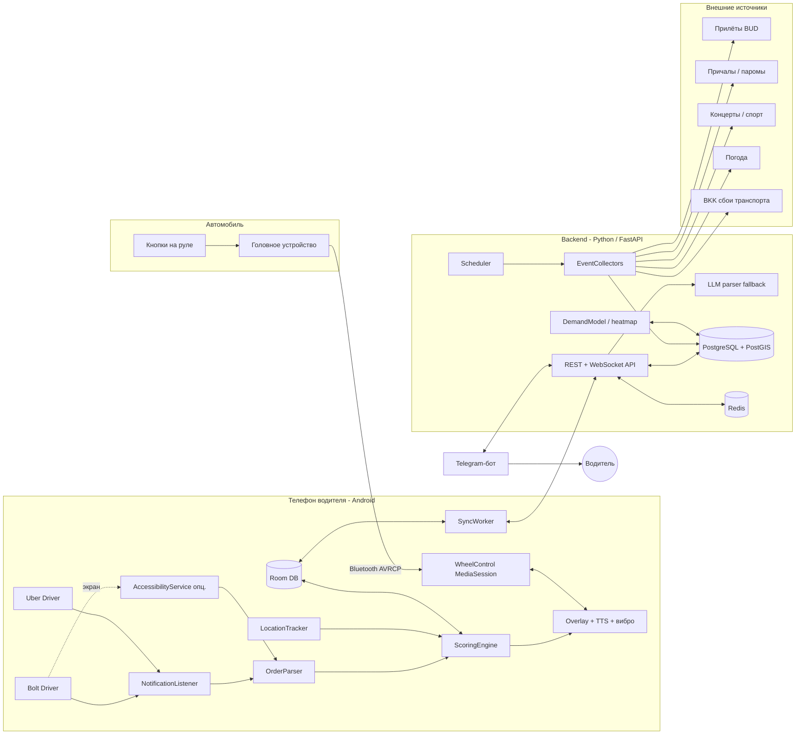
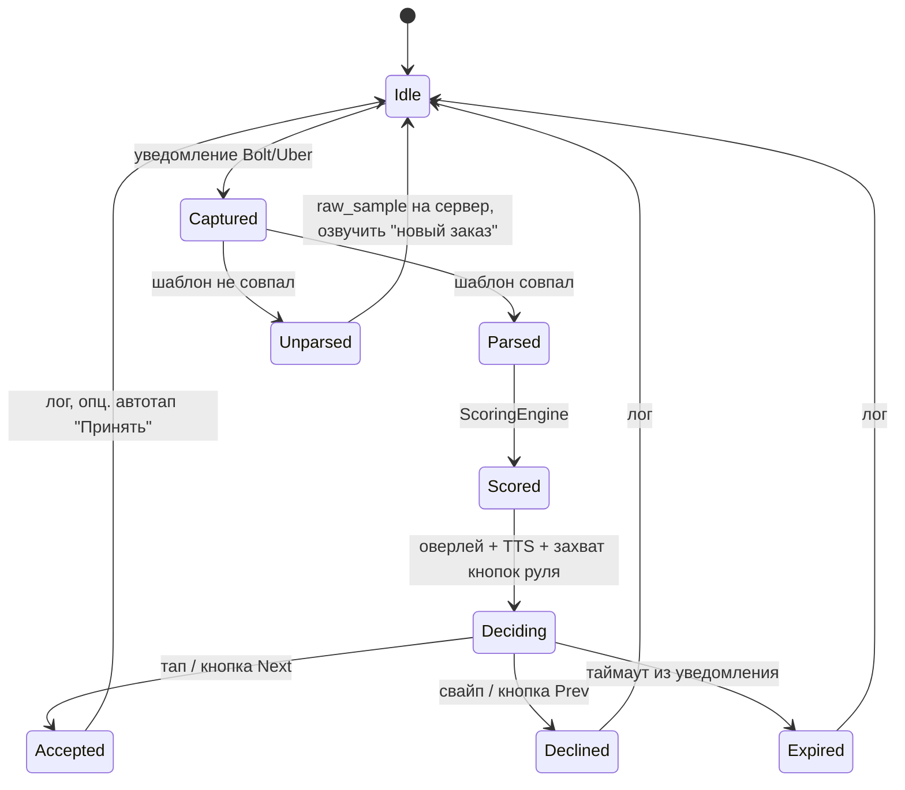

# TaxiPilot — помощник таксиста. Архитектура

Документ описывает целевую структуру системы: Android-приложение на телефоне водителя,
серверную часть (сбор событий и аналитика) и Telegram-бота (уже есть в репозитории, `bot.py`).

Связанные документы:

- [steering-wheel-control.md](steering-wheel-control.md) — управление приложением кнопками на руле (Bluetooth / AVRCP).

## 0. Допущения

Пока не подтверждено иное, проектирование ведётся с такими допущениями. Каждое из них
можно изменить, но изменение влияет на архитектуру (указано, на что именно).

| # | Допущение | Что меняется, если иначе |
|---|-----------|--------------------------|
| A1 | Телефон водителя — **Android** (9+). | На iOS перехват уведомлений других приложений невозможен; остаётся только ручной ввод / скриншоты. Теряется основной сценарий. |
| A2 | Регион — **Будапешт** (аэропорт BUD, причалы на Дунае, Puskás Aréna, MVM Dome, Sportaréna, Groupama Aréna, Hungaroring). | Меняются только адаптеры источников событий (раздел 5.2), ядро не меняется. |
| A3 | Режим решения — **«советник»**: приложение оценивает заказ и показывает/озвучивает рекомендацию, водитель подтверждает сам (экран или кнопка на руле). Автоматическое нажатие «Принять» в Bolt/Uber — только как опциональный, отключённый по умолчанию режим через `AccessibilityService`. | Полный автоприём повышает риск блокировки аккаунта в Bolt/Uber и несовместим с публикацией в Google Play. |
| A4 | Текущий репозиторий расширяется до монорепо: `android/`, `backend/`, `bot/`, `docs/`. | — |
| A5 | Формат уведомлений Bolt Driver / Uber Driver для региона пока неизвестен → парсер строится на **конфигурируемых шаблонах** с запасным разбором через LLM на сервере и сбором «сырых» образцов. | После получения реальных образцов шаблоны фиксируются, LLM-fallback становится редким. |

## 1. Цели и ключевые сценарии

1. **Заказ пришёл → решение за 2–3 секунды.** Уведомление перехвачено, распарсено, оценено,
   водителю озвучена рекомендация («Брать: 14 евро, подача 3 минуты, в аэропорт») и показан оверлей.
   Подтверждение — тап по оверлею или кнопка на руле.
2. **Где быть через 30–60 минут.** Приложение знает прилёты, прибытие судов, окончания концертов и
   матчей, погоду, сбои транспорта — и подсказывает, куда ехать «на подхват», с учётом текущей позиции.
3. **Смена как единое целое.** Учёт заработка, времени, простоя; целевой €/час; напоминание о
   перерывах; вечерний разбор смены в Telegram.
4. **Руки на руле.** Все критичные действия доступны без касания экрана: голос (TTS) + кнопки руля.

## 2. Общая архитектура



Принцип разделения: **всё, что влияет на решение по заказу в реальном времени, считается на телефоне
офлайн** (парсинг, скоринг, озвучка, кнопки руля). Сервер готовит данные заранее (события, тепловая карта
спроса по часам, калибровка коэффициентов) и отдаёт их пакетами; потеря связи не ломает основной сценарий.

## 3. Android-приложение (Kotlin)

### 3.1 Модули

| Модуль | Назначение | Ключевые технологии |
|--------|-----------|---------------------|
| `core-capture` | Перехват входящих заказов. Уровень 1: `NotificationListenerService` (пакеты `ee.mtakso.driver`, `com.ubercab.driver`). Уровень 2 (опц.): `AccessibilityService` читает дерево окна, если детали заказа показываются только на экране. Уровень 3 (резерв): `MediaProjection` + ML Kit OCR. | `NotificationListenerService`, `AccessibilityService`, ML Kit Text Recognition |
| `core-parser` | Преобразование текста уведомления в `OrderOffer`. Набор regex-шаблонов на приложение × язык × версию, с версионированием и доставкой с сервера. Неразобранные тексты складываются в очередь `raw_samples` и уходят на сервер для LLM-разбора и выпуска нового шаблона. | Kotlin, kotlinx.serialization |
| `core-scoring` | Оценка заказа (раздел 4). Полностью офлайн, цель < 100 мс. | чистый Kotlin, юнит-тесты |
| `feature-decision` | Оверлей поверх Bolt/Uber (`SYSTEM_ALERT_WINDOW`) с вердиктом и цифрами, TTS-озвучка, вибропаттерн; окно решения с таймаутом; приём подтверждения с экрана или руля. | `WindowManager`, `TextToSpeech`, `Vibrator` |
| `feature-wheel` | Управление кнопками на руле — см. [steering-wheel-control.md](steering-wheel-control.md). | `MediaSessionCompat`, `AudioFocus`, ExoPlayer (тихий поток) |
| `feature-autotap` | Опциональный «подтверждённый тап»: после явного действия водителя (кнопка руля / оверлей) находит кнопку «Принять» в окне Bolt/Uber и нажимает её. Выключен по умолчанию. | `AccessibilityService` (`performAction(ACTION_CLICK)`) |
| `feature-events` | Лента событий и карта: прилёты, суда, концерты, матчи; рекомендация «куда ехать» на горизонте 15/30/60 минут; пуши о «волнах» (например, 3 рейса за 20 минут). | Google Maps / MapLibre, `WorkManager` |
| `feature-shift` | Смена: старт/стоп, GPS-трек, учёт заказов (принятые/отклонённые/выполненные), €/час факт vs цель, перерывы. | `FusedLocationProvider`, foreground service |
| `feature-settings` | Целевой €/час, домашняя точка и время окончания смены, пороги, маппинг кнопок руля, включение автотапа, язык озвучки. | `DataStore` |
| `data-local` | Room: `orders`, `decisions`, `events`, `heatmap_cells`, `shift_log`, `raw_samples`. | Room |
| `data-remote` | Клиент API, синхронизация пачками (события на 24 ч, тепловая карта, шаблоны парсера, коэффициенты). | Retrofit/Ktor, `WorkManager` |
| `service-foreground` | Единый foreground-сервис (тип `location` + `mediaPlayback`), держит захват уведомлений, GPS и медиасессию живыми; защита от убийства системой (battery optimization whitelist, инструкция для MIUI/Samsung). | Foreground service, Android 14 типы сервисов |

### 3.2 Жизненный цикл заказа



Окно `Deciding` — единственный момент, когда приложение становится активной медиасессией и
перехватывает кнопки руля (если не включён постоянный режим, см. отдельный документ).

### 3.3 Модель данных `OrderOffer`

```kotlin
data class OrderOffer(
    val id: String,                 // хэш текста + времени
    val source: Source,             // BOLT | UBER
    val receivedAt: Instant,
    val expiresAt: Instant?,        // если в уведомлении есть таймер
    val fare: Money?,               // цена, если показана
    val surge: Double?,             // множитель
    val pickupDistanceKm: Double?,
    val pickupEtaMin: Int?,
    val tripDistanceKm: Double?,
    val tripEtaMin: Int?,
    val pickupAddress: String?,
    val dropoffAddress: String?,
    val pickupGeo: LatLng?,         // геокодирование локально (кеш) или по адресной маске
    val dropoffGeo: LatLng?,
    val riderRating: Double?,
    val paymentType: PaymentType?,  // CASH | CARD | UNKNOWN
    val rawText: String,
    val templateId: String?,
)
```

## 4. Оценка заказа (ScoringEngine)

Базовая метрика — **ожидаемый доход в час с учётом всего цикла**:

```
cycle_min   = pickup_eta + trip_eta + reposition_min(dropoff_zone, time)
fare_est    = fare ?: tariff_model(trip_km, trip_eta, surge)
eur_per_h   = fare_est / cycle_min * 60

score = eur_per_h
      * zone_factor(dropoff_zone, eta_at_dropoff)     // спрос в зоне прибытия по тепловой карте
      * event_factor(dropoff_geo, eta_at_dropoff)     // рядом заканчивается матч / прилёт волны
      * home_factor(dropoff_geo, shift_end)           // в конце смены ценим направление к дому
      * risk_factor(rider_rating, payment, pickup_km) // риск отмены / неоплаты
```

Решение:

- `score >= target_eur_per_h * 1.1` → **Брать** (зелёный, один короткий вибросигнал, TTS «Брать»).
- `target * 0.8 <= score < target * 1.1` → **На усмотрение** (жёлтый, озвучиваем цифры без вердикта).
- `score < target * 0.8` → **Пропустить** (красный, два коротких).

Особые правила (конфигурируемые):

- Нет цены в уведомлении → оценка по тарифной модели региона, вердикт помечается «оценочно».
- Подача > N км / M минут → «Пропустить» независимо от цены (настраиваемо).
- Направление в аэропорт / к причалу / на стадион в момент «волны» → бонус за вероятный обратный заказ.
- Водитель слишком долго без заказов (простой > X минут) → порог снижается, чтобы не стоять.

Все коэффициенты и тарифные модели — в JSON-конфиге, который приходит с сервера и кешируется.
Каждое решение и его исход (приехал / отменили / реальная цена) логируется — это основа для
последующей калибровки коэффициентов на сервере по данным конкретного водителя.

## 5. Backend (Python 3.12, FastAPI)

Python выбран, потому что бот уже на Python и экосистема парсинга/ML удобнее для сборщиков событий.

### 5.1 Сервисы

| Сервис | Назначение |
|--------|-----------|
| `api` | REST + WebSocket: аутентификация (телефон → JWT), выдача событий, тепловой карты, конфигов скоринга и шаблонов парсера; приём логов решений и `raw_samples`. |
| `collectors` | Периодические сборщики событий (ниже). Каждый источник — отдельный адаптер с единым интерфейсом `fetch() -> list[Event]`. Запуск по расписанию (APScheduler / Celery beat). |
| `demand` | Строит тепловую карту спроса по гексам (H3, разрешение 8) × час недели из истории заказов водителя(ей) + поправок от событий. Выдаёт `zone_factor`. |
| `parser-llm` | Разбор неизвестных форматов уведомлений через LLM, генерация кандидата regex-шаблона, ручное/полуавтоматическое утверждение. |
| `bot` | Telegram-бот (текущий `bot.py` → `bot/`): утренний план (волны прилётов, события дня), вечерняя сводка смены, алерты о сбоях транспорта, команды `/events`, `/shift`, `/target 25`. |

Хранилище: PostgreSQL + PostGIS (события с геометрией, гексы), Redis (кеш, pub/sub для WebSocket).

### 5.2 Источники событий (адаптеры)

| Категория | Источник (Будапешт) | Что извлекаем | Как превращаем в спрос |
|-----------|---------------------|---------------|-------------------------|
| Прилёты | AeroDataBox / FlightAware AeroAPI по ICAO `LHBP`; резерв — OpenSky (позиции бортов) и парсинг табло bud.hu | рейс, факт. время посадки, тип ВС (вместимость), терминал | пик выхода пассажиров ≈ +25…40 мин после посадки; суммирование по 15-мин корзинам → «волна» |
| Суда / паромы | Расписание причалов речных круизов (Pest-side rakpart), Mahart PassNave, портовые операторы; для других городов — паромные операторы | судно, причал, время швартовки, пассажировместимость | высадка в первые 30–60 мин, спрос в радиусе 500 м от причала |
| Поезда / автобусы | МÁV (международные Railjet/EuroCity, опоздания), FlixBus Népliget | прибытие, задержка | умеренный спрос на вокзалах; важны задержки ночных рейсов |
| Концерты, спорт | Ticketmaster Discovery API, PredictHQ (есть оценка посещаемости), парсинг jegy.hu / eventim.hu, календари Puskás Aréna, MVM Dome, Sportaréna, Groupama Aréna, Budapest Park, Hungaroring | площадка, старт, ожидаемая длительность, оценка аудитории | спрос на старте (−60…0 мин) и особенно на финише (+0…40 мин); окончание матча/концерта оценивается по типовой длительности, уточняется по факту (опц. ручная отметка «закончилось») |
| Погода | Open-Meteo | дождь, снег, резкое похолодание | множитель спроса по всему городу |
| Транспорт | BKK FUTÁR (GTFS-RT, алерты) | закрытие метро, замена автобусами | локальный множитель вдоль затронутой линии |
| Календарь | Праздники, Sziget, F1-уикенд, марафон (перекрытия) | даты, зоны | профили дня |

Единая сущность `Event`:

```
id, kind (FLIGHT|SHIP|TRAIN|CONCERT|SPORT|WEATHER|TRANSIT|HOLIDAY),
title, venue_id, geo (point), starts_at, ends_at (ожид.), ends_confirmed_at,
expected_people, confidence, source, source_ref, updated_at
```

`Venue`: id, name, geo, тип, типовая «точка посадки», средняя задержка выхода, вместимость.

### 5.3 Рекомендация «куда ехать»

Каждые 5 минут (или по запросу) для текущей позиции водителя считается набор кандидатов:
`value(venue, t) = expected_people(t) * take_rate / competing_drivers_est − travel_cost(pos → venue)`.
Возвращаются топ-3 с временем выезда («выезжайте в 21:35, чтобы быть к волне в 21:55»).
Пуш приходит только если лучший кандидат заметно лучше текущей позиции (гистерезис, чтобы не дёргать).

## 6. Модель данных (сервер)

- `drivers` — id, телефон, настройки (target €/час, дом, тип авто), telegram_chat_id.
- `orders` — распарсенные предложения (без персональных данных пассажиров), решение, исход.
- `raw_samples` — нераспознанные тексты уведомлений для выпуска шаблонов.
- `parser_templates` — app, lang, version, regex, тесты-примеры, статус.
- `events`, `venues` — см. выше.
- `heatmap_cells` — h3_index, dow, hour, demand_score, updated_at.
- `shifts`, `shift_points` — смены и GPS-трек (хранить с прореживанием).
- `scoring_configs` — версии коэффициентов, персональные переопределения.

## 7. Риски и ограничения

| Риск | Смягчение |
|------|-----------|
| Нарушение ToS Bolt/Uber при автоприёме | По умолчанию только советник; автотап — явный опт-ин, только после действия водителя, с предупреждением. |
| Google Play не пропустит `AccessibilityService`/оверлеи для такого назначения | Распространение через собственный APK/F-Droid-подобный канал; `NotificationListener` и оверлей сами по себе допустимы при декларации. |
| Формат уведомлений меняется с обновлением Bolt/Uber | Шаблоны доставляются с сервера без обновления приложения; LLM-fallback; алерт при росте доли `Unparsed`. |
| Детали заказа не попадают в уведомление (только на экране) | Уровень 2 (`AccessibilityService` чтение окна) / уровень 3 (OCR). |
| Убийство фонового сервиса (Xiaomi, Samsung, Huawei) | Foreground-сервис, whitelist батареи, онбординг с инструкциями по производителю, watchdog через `WorkManager`. |
| Батарея (GPS + сервис + медиасессия) | GPS с адаптивным интервалом; медиасессия активна только в окне решения (по умолчанию). |
| Платные API событий | Абстракция адаптеров; старт на бесплатных (Open-Meteo, OpenSky, Ticketmaster free tier, парсинг), платные — по мере пользы. |
| Персональные данные пассажиров в уведомлениях | На сервер уходят только обезличенные поля; `raw_samples` маскируются (имена, телефоны) на телефоне до отправки. |

## 8. Структура репозитория (целевая)

```
.
├── android/                 # Kotlin, Gradle, модули из раздела 3.1
│   ├── app/
│   ├── core-capture/ core-parser/ core-scoring/
│   ├── feature-decision/ feature-wheel/ feature-events/ feature-shift/ feature-autotap/ feature-settings/
│   └── data-local/ data-remote/
├── backend/                 # FastAPI
│   ├── app/api/ app/collectors/ app/demand/ app/parser_llm/
│   ├── migrations/ (alembic)
│   └── tests/
├── bot/                     # текущий bot.py переезжает сюда и подключается к backend API
├── docs/
│   ├── architecture.md
│   └── steering-wheel-control.md
├── Procfile                 # web: backend, worker: collectors, bot: bot
└── requirements.txt → backend/requirements.txt, bot/requirements.txt
```

## 9. Этапы реализации

Порядок выбран так, чтобы ценность появлялась как можно раньше и каждый этап проверялся на реальной смене.

1. **Захват и парсинг.** `NotificationListenerService`, лог «сырых» уведомлений Bolt/Uber, первые шаблоны по реальным образцам. Результат: приложение видит и разбирает заказы.
2. **Скоринг + оверлей + TTS.** Офлайн-оценка, вердикт на экране и голосом, лог решений. Результат: советник работает без сервера.
3. **Кнопки на руле.** Модуль `feature-wheel` по [steering-wheel-control.md](steering-wheel-control.md): подтверждение/отклонение и повтор озвучки без касания экрана; информация о заказе на дисплее магнитолы.
4. **Backend минимум.** Авторизация, синхронизация логов, доставка шаблонов и конфигов скоринга, LLM-fallback парсера.
5. **События: прилёты и погода.** Первые два адаптера, лента событий в приложении, утренний план в Telegram.
6. **События: суда, концерты, спорт, транспорт.** Остальные адаптеры, `Venue`-справочник, рекомендация «куда ехать».
7. **Тепловая карта и калибровка.** H3-гексы из истории, персональная подстройка коэффициентов по исходам.
8. **Опциональный автотап.** `AccessibilityService` с подтверждением от водителя, предупреждения о рисках.

## 10. Открытые вопросы

Ответы уточнят допущения из раздела 0:

1. Android подтверждается? Какая модель телефона (важно для фоновых ограничений производителя)?
2. Город подтверждается (Будапешт)? Работаете ли за городом (аэропорт в другом городе, паромы на Балатоне)?
3. Нужны ли 2–3 реальных текста уведомлений Bolt Driver и Uber Driver — это самое ценное для старта парсера. Можно прислать скриншоты.
4. Устраивает ли режим «советник» с опциональным подтверждённым автотапом, или нужен полностью автоматический приём?
5. Какая магнитола/автомобиль (марка, год) — чтобы заранее проверить особенности AVRCP и отображения метаданных на дисплее.
