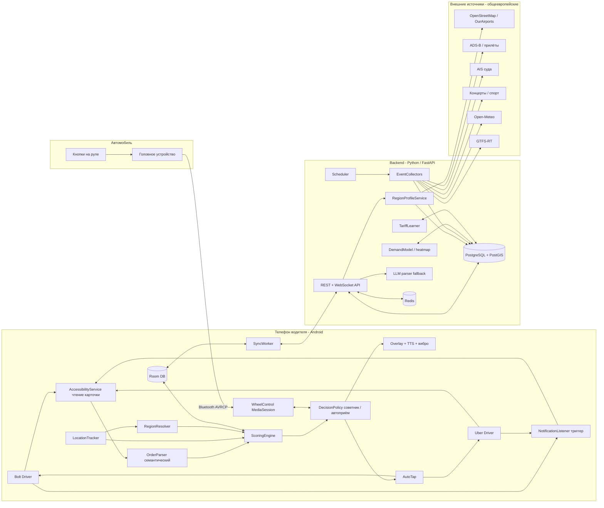
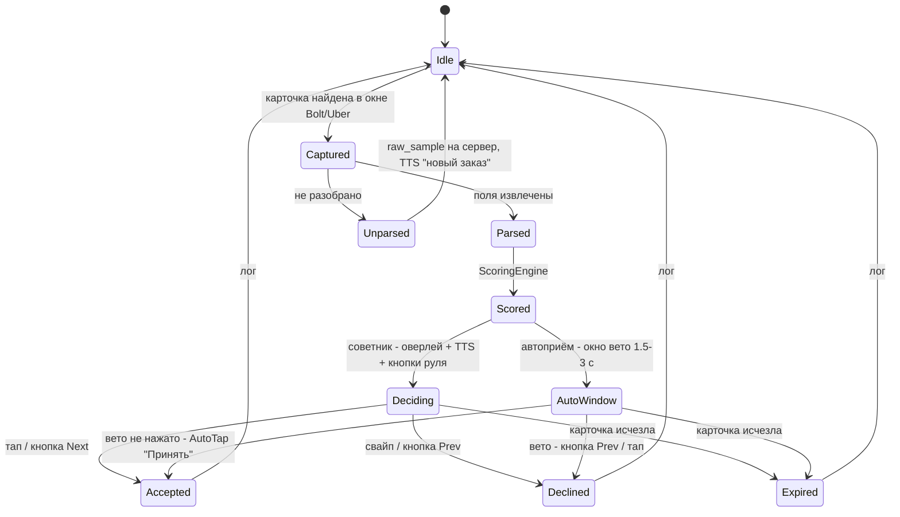

# TaxiPilot — помощник таксиста. Архитектура

Документ описывает целевую структуру системы: Android-приложение на телефоне водителя и серверную
часть (сбор событий, профили регионов, аналитика). Проект самостоятельный: Telegram-бот из этого
репозитория (`bot.py`) в него не входит и не изменяется.

Связанные документы:

- [order-capture-and-parsing.md](order-capture-and-parsing.md) — перехват карточки заказа Bolt/Uber, парсер, автоприём. Содержит разбор реальных образцов.
- [steering-wheel-control.md](steering-wheel-control.md) — управление приложением кнопками на руле (Bluetooth / AVRCP, HFP-кнопка «голос», BT-пульт).
- [vehicle-compatibility.md](vehicle-compatibility.md) — какие машины ездят в Uber/Bolt в Европе и как управление с руля поддерживается на каждой платформе мультимедиа.
- [reports.md](reports.md) — отчёты за сутки и по часам по всем предложениям заказов.

## 0. Исходные условия

Подтверждено заказчиком:

| # | Условие | Следствие для архитектуры |
|---|---------|---------------------------|
| C1 | Телефон водителя — **Android** (на скриншотах Samsung / One UI). | Перехват содержимого экрана через `AccessibilityService`, оверлеи, медиасессия — всё доступно. Отдельно учитываем агрессивное энергосбережение Samsung. |
| C2 | **Любой европейский город**, регион определяется по местоположению водителя. | Нет ручной настройки города. Модуль `core-region` строит профиль региона (валюта, аэропорты, порты, площадки, источники событий) автоматически; источники событий — в первую очередь общеевропейские, локальные адаптеры — как уточнение. |
| C3 | Режим **«советник» + опциональный автоприём** (вариант B). | `AccessibilityService` нужен в любом случае (для чтения карточки), автоприём — нажатие «Принять» тем же сервисом по политике водителя, с предохранителями. |
| C4 | Новый проект **с нуля**, бот не трогаем. | Отдельный репозиторий `taxipilot` (Android + backend). Этот репозиторий содержит только проектную документацию. |
| C5 | Получены 4 реальных карточки заказов (Bolt ×2, Uber ×2; RU и PL интерфейс; Труймясто, PLN). | Данные заказа живут в **карточке внутри приложения**, не в уведомлении. Парсер — семантический, не зависящий от языка интерфейса (см. отдельный документ). |
| C6 | Тег Bolt «Срок» = **предварительный (запланированный) заказ**. | Тег `SCHEDULED`; такие заказы идут отдельным потоком, не сравниваются с текущими по эффективности. |
| C7 | **Bolt показывает сумму «на руки»**; **Uber — сумму до своей комиссии**, причём комиссия **переменная**. Подтверждено документацией Uber: сервисный сбор меняется от поездки к поездке (в Польше 3–40 %, в среднем ~25 %), зависит от точности upfront-цены и вычисляется при принятии; плюс 23 % VAT на сбор. | Для Uber `net` — это оценка: `price × (1 − fee_est)`, где `fee_est` обучается по фактическим выплатам водителя (раздел 4.1). Сравнение Bolt и Uber без этого некорректно. |
| C8 | **Целевого дохода в час нет; цель — максимизировать доход.** Оценка заказа должна учитывать два фактора: ставку за км (с подачей и поездкой) и ставку за время (подача + поездка). | Скоринг без ручного порога: индекс эффективности из двух нормированных ставок + адаптивный порог по потоку предложений (раздел 4). |
| C9 | Парк: **Toyota Prius 20/30/40, Prius+, Corolla Hybrid 2018+**; большинство водителей пользуются только телефоном; у старых Prius нет своего дисплея, но есть Bluetooth телефона и/или мультимедиа. | Проверено по документации: Prius 20 — только HFP (звонки), кнопки руля треки не переключают; Prius 30 (2010+)/40/Prius+/Corolla — A2DP+AVRCP, кнопки Seek работают при источнике «BT Audio». Добавлен второй канал — кнопка «голос» на руле через HFP. Детали — в [steering-wheel-control.md](steering-wheel-control.md), раздел 11. |
| C10 | Авторизация в приложении — **по e-mail и паролю**. | Модуль `feature-auth` и сервис `auth` на сервере (раздел 5.4). |

## 1. Цели и ключевые сценарии

1. **Заказ пришёл → решение за 2–3 секунды.** Карточка перехвачена из окна Bolt/Uber, распарсена,
   оценена; водителю озвучена рекомендация («Uber: 26 злотых, подача 2 минуты, 18 минут поездки — брать»)
   и показан оверлей. Подтверждение — тап, кнопка на руле или автоприём по политике.
2. **Где быть через 30–60 минут.** Приложение знает прилёты, швартовку паромов и круизных судов,
   окончания концертов и матчей, погоду, сбои транспорта — и подсказывает, куда ехать, с учётом позиции.
3. **Смена как единое целое.** Заработок, время, простой; фактические ставки за км и за час против референса региона; разбор смены.
4. **Руки на руле.** Все критичные действия доступны без касания экрана: голос (TTS) + кнопки руля.
5. **Новый город без настройки.** Водитель приехал в другой город/страну — через минуту приложение знает
   местные аэропорты, порты, стадионы и валюту.

## 2. Общая архитектура



Принцип разделения: **всё, что влияет на решение по заказу в реальном времени, считается на телефоне
офлайн** (перехват, парсинг, скоринг, политика, озвучка, кнопки руля, автотап). Сервер готовит данные
заранее (профиль региона, события, тепловая карта, тарифная модель) и отдаёт их пакетами; потеря связи
не ломает основной сценарий.

## 3. Android-приложение (Kotlin)

### 3.1 Модули

| Модуль | Назначение | Ключевые технологии |
|--------|-----------|---------------------|
| `core-capture` | Перехват карточки заказа. **Основной путь:** `AccessibilityService` читает дерево окна Bolt Driver (`ee.mtakso.driver`) / Uber Driver (`com.ubercab.driver`) при событиях изменения окна, находит карточку по якорям (кнопка «Принять» в любом языке + цена) и отдаёт упорядоченный список текстов. **Триггер:** `NotificationListenerService` ловит уведомление «новый заказ» и форсирует немедленное чтение окна. **Резерв:** `MediaProjection` + ML Kit OCR, если карточка отрисована без текстовых узлов. Детали — в [order-capture-and-parsing.md](order-capture-and-parsing.md). | `AccessibilityService`, `NotificationListenerService`, ML Kit |
| `core-parser` | Семантический парсер: не зависит от языка интерфейса, опирается на форму данных (цена с валютой, пары «минуты • км», рейтинг, адреса) и на многоязычные словари тегов/квалификаторов. Выход — `OrderOffer`. Неразобранное → `raw_samples` на сервер, LLM-разбор, выпуск правила. | Kotlin, тесты на реальных образцах |
| `core-region` | Определяет регион по GPS: страна, валюта, часовой пояс, язык(и); запрашивает/кеширует `RegionProfile` с сервера (аэропорты, порты, площадки, тарифная модель, активные источники событий). Пересчёт при смещении > 30 км или смене страны. Офлайн-минимум: страна и валюта из встроенного набора полигонов. | Bundled GeoJSON стран, `FusedLocationProvider` |
| `core-scoring` | Оценка заказа (раздел 4). Полностью офлайн, цель < 100 мс. | чистый Kotlin |
| `feature-decision` | `DecisionPolicy` (советник / автоприём с условиями), оверлей поверх Bolt/Uber (`SYSTEM_ALERT_WINDOW`) с вердиктом и цифрами, TTS, вибропаттерн; окно решения с таймаутом; приём подтверждения с экрана, руля или от политики. | `WindowManager`, `TextToSpeech`, `Vibrator` |
| `feature-autotap` | Нажатие «Принять»/«Отклонить» в окне Bolt/Uber через тот же `AccessibilityService`. Используется (а) после явного действия водителя (кнопка руля), (б) в режиме автоприёма — по политике. Предохранители: см. отдельный документ, раздел 6. | `AccessibilityNodeInfo.performAction`, `dispatchGesture` |
| `feature-wheel` | Управление кнопками на руле — [steering-wheel-control.md](steering-wheel-control.md); профили головных устройств и автоопределение машины — [vehicle-compatibility.md](vehicle-compatibility.md). | `MediaSessionCompat`, `AudioFocus`, ExoPlayer, `BluetoothHeadset` |
| `feature-reports` | Отчёты за сутки и по часам по всем предложениям: агрегатор часовых корзин, генератор инсайтов, экран с часовой лентой, экспорт CSV/PDF, сводки в конце смены и утром — [reports.md](reports.md). | Room, `WorkManager`, `PdfDocument` |
| `feature-events` | Лента событий и карта: прилёты, суда, концерты, матчи; рекомендация «куда ехать» на горизонте 15/30/60 минут; пуши о «волнах». | MapLibre, `WorkManager` |
| `feature-shift` | Смена: старт/стоп, GPS-трек, учёт заказов (принятые/отклонённые/выполненные), факт vs цель, перерывы. | `FusedLocationProvider`, foreground service |
| `feature-auth` | Регистрация и вход по e-mail и паролю, подтверждение e-mail, сброс пароля, хранение токенов в Android Keystore, офлайн-вход по кешированной сессии, выход со всех устройств. | `EncryptedSharedPreferences`, Ktor Auth |
| `feature-settings` | Панель всех пользовательских переменных (полный каталог — раздел 4.7): порог длинной поездки и параметры возврата, ночной интервал и ночные правила, себестоимость км, вес `α`, лимиты подачи, наличные, рейтинг, комиссии/флот, режим решения и автоприём, дом и смена, руль/голос, озвучка, отчёты. Живой пример влияния на последнем заказе; сброс к рекомендованным; синхронизация в профиль. | `DataStore` (Proto) |
| `core-routing` | Офлайн-оценка дорожного расстояния и времени (для возврата в исходную точку при длинных поездках и для `reposition_min`): кеш матриц расстояний между гексами H3 региона с сервера (OSRM/Valhalla), при промахе — haversine × 1.3. | H3, Room |
| `feature-onboarding` | Пошаговая выдача разрешений (Accessibility, уведомления, оверлей, батарея) с инструкциями по производителю (Samsung: «Никогда не переводить в спящий режим»). | — |
| `data-local` | Room: `orders`, `decisions`, `events`, `venues`, `heatmap_cells`, `shift_log`, `raw_samples`, `region_profiles`. | Room |
| `data-remote` | Клиент API, синхронизация пачками (профиль региона, события на 24 ч, тепловая карта, правила парсера, коэффициенты). | Ktor, `WorkManager` |
| `service-foreground` | Единый foreground-сервис (типы `location` + `mediaPlayback`); watchdog; защита от убийства системой. | Foreground service |

### 3.2 Жизненный цикл заказа



### 3.3 Модель данных `OrderOffer`

```kotlin
data class OrderOffer(
    val id: String,                  // хэш (платформа, цена, адреса) — дедупликация повторных событий окна
    val platform: Platform,          // BOLT | UBER
    val product: String?,            // "Bolt", "UberX", "UberX Priority", "Comfort"…
    val capturedAt: Instant,
    val price: Money,                // как показано на карточке
    val priceBasis: PriceBasis,      // Bolt: NET_AFTER_COMMISSION; Uber: GROSS_BEFORE_VARIABLE_FEE
    val priceNet: Money,             // оценка «на руки»: Bolt = price; Uber = price × (1 − fee_est)
    val ratePerKm: Money?,           // Uber показывает "≈3,35 PLN/км" = price / (pickup_km + trip_km)
    val bonus: Money?,               // "+4,59 zł за приоритет"
    val pickupEtaMin: Int?, val pickupKm: Double?, val pickupAddress: String?,
    val tripEtaMin: Int?,   val tripKm: Double?,   val dropoffAddress: String?,
    val pickupGeo: LatLng?, val dropoffGeo: LatLng?,   // геокодирование локально (кеш) / на сервере
    val riderName: String?, val riderRating: Double?,
    val tags: Set<OfferTag>,         // CASH, OUT_OF_RANGE, SCHEDULED, EXCLUSIVE, PRIORITY, NO_PENALTY_DECLINE
    val isLongTrip: Boolean,         // trip_km >= long_trip_km (настройка) → оценка по кругу с возвратом (4.2a)
    val isNight: Boolean,            // момент предложения в ночном интервале (настройка) → ночной референс (4.2b)
    val returnKm: Double?, val returnMin: Int?,   // dropoff → origin, только для длинных
    val uiLocale: String?,           // "ru", "pl" — определено по словарю
    val rawLines: List<String>,
    val ruleId: String?,
)
```

## 4. Оценка заказа (ScoringEngine)

Цель — **максимизировать доход за смену**, а не выполнить план. Поэтому у скоринга нет ручного порога
«zł/час»: заказ сравнивается с тем, что реально предлагают здесь и сейчас, и с тем, что водитель
теряет, отказываясь.

### 4.1 Чистый доход заказа (`net`)

```
Bolt:  net = price                                   // карточка уже показывает сумму «на руки»
Uber:  net = price × (1 − fee_est) + bonus_shown     // карточка показывает сумму до переменной комиссии
       fee_est = fee_model(platform, region, pickup_min, trip_min, driver)   // старт 25 % × 1.23 VAT ≈ 30.75 %
```

Комиссия Uber по документации Uber Poland меняется 3–40 % от поездки к поездке (в среднем ~25 %),
снижается при длинной подаче и завышенной фактической длительности, вычисляется при принятии — заранее
не известна. `fee_model` стартует с 25 % (+23 % VAT, если водитель/флот не вычитает VAT) и
**обучается на фактах**: после завершения поездки приложение читает экран «детали поездки» в Uber
(тем же `AccessibilityService`) или водитель импортирует недельную выписку; пары (предложение → выплата)
дают регрессию комиссии по признакам заказа. Пока фактов мало — используем среднее региона с сервера.

Прочие вычеты (партнёр-флот, его комиссия и VAT-обработка) — настройки водителя, применяются к обеим платформам.

### 4.2 Две ставки, обе с учётом подачи

```
total_km  = pickup_km  + trip_km
total_min = pickup_min + trip_min

R_km = net / total_km            // zł за километр, включая холостой пробег к пассажиру  (подход 1)
R_h  = net / total_min × 60      // zł за час, включая время подачи                       (подход 2)
```

Проверка на образце: Uber показывает «≈3,35 PLN/км» для 26,46 zł при 1,3 + 6,6 км → 26,46 / 7,9 = 3,35.
Uber сам считает ставку на суммарный километраж с подачей — `R_km` совпадает с его метрикой.

Почему нужны обе: `R_km` отражает **себестоимость** (топливо, износ пропорциональны километрам),
`R_h` — **упущенную выгоду** (час, потраченный на этот заказ, нельзя продать другому). Длинная
загородная поездка может иметь хороший `R_h`, но посредственный `R_km` и пустой обратный путь;
короткая городская — наоборот.

### 4.2a Длинные поездки: километры с возвратом в исходную точку

Для коротких городских заказов после высадки водитель остаётся в зоне спроса и следующий заказ
приходит рядом. Для длинных — чаще всего приходится возвращаться пустым. Поэтому заказы с
`trip_km ≥ long_trip_km` (настройка, по умолчанию **25 км**) оцениваются по **полному кругу**:

```
return_km   = roadDistance(dropoff → origin)      // origin = позиция водителя в момент предложения;
                                                  // дорожное расстояние из офлайн-роутера (OSRM/Valhalla в кеше
                                                  // региона), при недоступности — haversine × 1.3
return_min  = roadTime(dropoff → origin)

full_km     = pickup_km  + trip_km  + return_km × return_weight
full_min    = pickup_min + trip_min + return_min × return_weight

R_km_long   = net / full_km                       // «цена за километр круга» — главная метрика длинного заказа
km_per_zl   = full_km / net                       // то же в форме «км на 1 злотый», для озвучки водителям, привыкшим к ней
R_h_long    = net / full_min × 60
```

`return_weight` — ожидание, что обратно придётся ехать пустым. По умолчанию 1.0 (полный возврат),
но снижается автоматически, если в зоне высадки есть спрос: `return_weight = 1 − P(заказ в зоне
высадки в ближайшие 20 мин)` из тепловой карты и событий (аэропорт в момент волны → ≈ 0.2;
деревня ночью → 1.0). Водитель может зафиксировать `return_weight` вручную в настройках.

Для длинного заказа `E` считается из `R_km_long` и `R_h_long` вместо `R_km` и `R_h`, при этом
`deadhead_factor` из таблицы 4.3 **не применяется** (возврат уже учтён в километрах, иначе штраф
двойной). Нормирование — на те же медианы региона, поэтому длинный заказ честно сравнивается с
городскими: он должен «окупать» и обратную дорогу.

Жёсткое правило себестоимости для длинных поездок тоже считается по кругу: `net < c_km × full_km` →
пропустить. Отдельный порог `long_trip_min_R_km` (по умолчанию = `c_km × 1.6`, т.е. ≈ 0,9 zł/км для
Prius) задаёт минимально приемлемую цену километра круга — ниже него длинный заказ не рекомендуется,
даже если `E` формально проходит порог потока (в мёртвое время порог потока мягкий, а 60 км
пустого возврата — нет).

Пример (Uber Priority 26,46 → Kolbudy, если бы поездка была 30 км): `net ≈ 18,3`, `pickup 1,3 +
trip 30 + return 28 × 0,9 = 56,5 км` → `R_km_long = 0,32 zł/км` — ниже себестоимости, пропустить;
тот же заказ при цене 110 zł нетто → 1,95 zł/км — приемлемо.

Озвучка длинного заказа отличается: «Длинная: 48 километров, обратно 40. 1,9 за километр круга.
Нормально.» — водитель слышит именно ту метрику, по которой принято решение.

Что считается «длинным», где брать `origin` (позиция сейчас vs «домашняя» точка водителя) и
`return_weight` — всё в настройках (раздел 4.7).

### 4.2b Ночные заказы

Ночь — другой рынок: меньше предложений, выше цены, выше риск, дороже ошибка (следующий заказ может
не прийти час). Поэтому ночные заказы оцениваются **против ночного референса**, а не дневного, и
с отдельным набором правил.

Определение ночи: интервал `night_start … night_end` (настройка, по умолчанию **22:00–06:00**
локального времени региона). Заказ считается ночным, если ночным является **момент предложения**;
дополнительно помечается `ends_in_night`, если ожидаемое окончание круга попадает в ночь.

Что меняется ночью:

| Компонент | Днём | Ночью |
|-----------|------|-------|
| Референс медиан (`median_R_km`, `median_R_h`) | daypart утро/день/вечер | daypart **ночь** — отдельные медианы; при малом объёме данных ночь делится на `late_evening` (22–01) и `deep_night` (01–06) только когда накоплено ≥ 200 предложений |
| Порог потока `E*` | `p(λ)` 0.25…0.70 | `p` ограничен сверху `night_p_max` (по умолчанию 0.45): ночью не капризничаем — поток редкий, а «подождать лучшего» дороже |
| Себестоимость `c_km` | базовая | `c_km × night_cost_factor` (по умолчанию 1.0; водитель может поднять — усталость, риск) |
| Длинные поездки | `long_trip_km` | `night_long_trip_km` (по умолчанию = дневному); `return_weight` ночью по умолчанию 1.0 — обратно почти наверняка пусто, тепловая карта ночью сильно разрежена |
| Риск | `risk_factor` по рейтингу | плюс `night_risk`: рейтинг < 4,7 ночью штрафуется сильнее (0,8 вместо 0,85); `CASH` ночью — по отдельной настройке (многие водители ночью наличные не берут) |
| Направление | `home_factor` в последний час | `home_factor` действует последние **2 часа** ночной смены и усилен (до 1.3): ночью «ехать домой с пассажиром» ценнее |
| Зона высадки | `zone_factor` | ночью добавляется `night_zone_penalty` для зон без ночного спроса (спальные районы, пригород): вероятность вернуться пустым |
| Автоприём | условия политики | ночью `Auto` требует `minScoreRatio` выше (по умолчанию 1.25) и `requireRating` 4.8 — автоматика ночью консервативнее |

Ночные надбавки платформ (Bolt/Uber ночной тариф или сурж) уже входят в `price`, отдельно не
учитываются — именно поэтому важно сравнивать с ночными медианами, а не дневными: иначе каждый
ночной заказ выглядел бы «выгодным» просто из-за тарифа.

Озвучка ночью короче и без лишних слов (меньше когнитивной нагрузки): «Ночь. Болт, 42, подача 6. Брать.»

В отчётах ([reports.md](reports.md)) часы ночного интервала выделяются, а дневная сводка отдельно
показывает `R_h_realized` за ночь против ночной медианы региона.

### 4.3 Индекс эффективности `E`

Ставки нормируются на **референс региона и времени суток** — скользящие медианы по предложениям
последних 7 дней в этом регионе, в том же часовом поясе дня (утро/день/вечер/ночь), по всем
водителям приложения; при отсутствии данных — медианы собственных предложений водителя, затем
значения по умолчанию для страны с сервера.

```
r_km = R_km / median_R_km(region, daypart)
r_h  = R_h  / median_R_h (region, daypart)

E = r_km^α · r_h^(1−α)         // геометрическое среднее; α = 0.4 по умолчанию
```

Геометрическое среднее штрафует перекос: заказ с `r_h = 1.6`, но `r_km = 0.5` получит `E ≈ 0.94`,
а не 1.05, как при арифметическом. `α` настраивается (водитель на дорогом в обслуживании авто сдвигает
к километрам, водитель в часы пик — ко времени); сервер может подбирать `α` по исходам.

Поправки (множители к `E`, каждый 0.7–1.3, настраиваемы):

| Множитель | Смысл |
|-----------|-------|
| `zone_factor(dropoff, ETA)` | спрос в зоне высадки по тепловой карте: вероятность быстрого следующего заказа |
| `event_factor(dropoff, ETA)` | в момент прибытия рядом заканчивается матч / волна прилётов / швартовка |
| `deadhead_factor(dropoff)` | ожидаемый пустой пробег обратно (из тарифной модели и карты) — главный штраф загородных поездок |
| `home_factor(dropoff, shift_end)` | в последний час смены — бонус направлению к дому |
| `risk_factor(rating, tags)` | рейтинг пассажира, `CASH` по предпочтению, `EXCLUSIVE` небольшой плюс |

### 4.4 Порог: не константа, а стоимость ожидания

Отказ имеет цену — следующий заказ придёт не сразу и не обязательно лучше. Поэтому порог принятия
`E*` вычисляется из **текущего потока предложений**:

```
λ      = предложений в час за последние 60 мин (в текущей зоне, сглажено по тепловой карте)
p(λ)   = квантиль требовательности: 0.25 при λ ≤ 2/ч … 0.70 при λ ≥ 10/ч (кусочно-линейно)
E*     = quantile(E за последние 7 дней в регионе/daypart, p(λ))
```

В «мёртвое» время берём почти всё, что выше себестоимости; в час пик — только верхнюю треть
предложений. Дополнительно: простой > 15 мин снижает `p` на 0.1 за каждые 10 мин; простой — сигнал, что
λ переоценена.

Жёсткие правила срабатывают до индекса:

| Правило | Пример из образцов | Действие |
|---------|--------------------|----------|
| Себестоимость: `net < c_km × total_km` | — | **Пропустить** (`c_km` по умолчанию 0,55 zł/км для Prius: топливо ≈ 0,30 + износ ≈ 0,25; настраивается) |
| `OUT_OF_RANGE` и подача > 20 мин | Bolt: подача 45 мин / 45,7 км ради 10 мин поездки | **Пропустить** |
| `SCHEDULED` | Bolt: тег «Срок» | Отдельный поток: озвучить время и цену, показать в календаре смены, не сравнивать с текущими |
| Рейтинг < 4,5 | — | `risk_factor` 0,85 |
| Автоприём: условия политики | — | см. order-capture-and-parsing.md, раздел 4 |

Вердикт и озвучка:

- `E ≥ E* × 1.15` → **Брать**: «Uber, 26 злотых, подача 2, поездка 18. Хорошо.»
- `E* × 0.9 ≤ E < E* × 1.15` → **На усмотрение**: озвучиваем обе ставки: «3,4 за километр, 58 в час.»
- `E < E* × 0.9` → **Пропустить**: «Слабо: 1,1 за километр.»

Оверлей всегда показывает три числа: `E` (относительно типичного, например «+30 %»), `R_km`, `R_h`;
для длинных поездок вместо них — `R_km_long`, `return_km` и `km_per_zl`; ночью — значок луны и
сравнение с ночной медианой.

### 4.5 Примеры на реальных карточках (медианы условно: 2,6 zł/км, 48 zł/ч)

| Карточка | net | total_km | total_min | R_km | R_h | r_km | r_h | E | Вердикт |
|----------|-----|----------|-----------|------|-----|------|-----|---|---------|
| Uber Priority 26,46 | 26,46 × 0,69 ≈ 18,3 | 7,9 | 20 | 2,31 | 54,8 | 0,89 | 1,14 | 1,03 | на усмотрение → брать при `deadhead_factor` Kolbudy ≥ 0,95 и низком λ |
| Uber X 9,54 | 9,54 × 0,69 ≈ 6,6 | 6,9 | 11 | 0,95 | 35,9 | 0,37 | 0,75 | 0,56 | пропустить |
| Bolt 16,70 (вне радиуса) | 16,70 | 51,8 | 55 | 0,32 | 18,2 | — | — | — | жёсткое правило: себестоимость и OUT_OF_RANGE |
| Bolt 8,93 | 8,93 | 13,4 | 20 | 0,67 | 26,8 | 0,26 | 0,56 | 0,41 | пропустить |

Показательно, что «Uber Priority 26,46» выглядит отлично по цене, но после оценки комиссии и с учётом
подачи становится средним — именно такие заказы приложение должно отличать от действительно выгодных.

### 4.6 Тарифная модель и обучение

- `TariffLearner` (сервер): регрессия `price ~ a + b·trip_km + c·trip_min` по платформе и региону — для
  заказов без цены, оценки обратной поездки, выявления суржа.
- `FeeLearner` (сервер + телефон): модель комиссии Uber по фактам выплат.
- Референсные медианы и квантили `E` по регионам/daypart пересчитываются на сервере ежечасно и
  приходят в приложение пакетом; телефон считает всё остальное офлайн.
- Каждое решение и исход (принят / отменён / реальная выплата) логируются — сервер подбирает `α`
  и множители, максимизируя фактический доход в час по журналу водителя.

### 4.7 Панель настроек: все переменные, которые задаёт водитель

Все перечисленные ниже параметры доступны в приложении (модуль `feature-settings`), сгруппированы
по экранам. Принцип: **у каждого параметра есть разумное значение по умолчанию**, приложение работает
без настройки; но любое число, влияющее на решение, водитель может изменить сам. Значения с сервера
(медианы, коэффициенты) настройками не являются и показываются только для информации.

Хранение — `DataStore` (Proto), синхронизация с сервером в профиль водителя (чтобы при смене телефона
настройки сохранились). Любое изменение логируется с временем — отчёты и калибровка знают, при каких
настройках принималось решение.

**Экран «Оценка заказа»**

| Параметр | Ключ | По умолчанию | Диапазон / тип | На что влияет |
|----------|------|--------------|----------------|---------------|
| Длинная поездка от | `long_trip_km` | 25 км | 10–100 км, шаг 1 | с какой длины поездки включается оценка по кругу (4.2a) |
| Точка возврата | `return_origin` | текущая позиция | текущая позиция / домашняя точка / центр города региона | куда считать обратный путь |
| Учитывать возврат на | `return_weight_mode` | автоматически | авто (по спросу в зоне высадки) / фиксировано | — |
| Доля пустого возврата | `return_weight_fixed` | 1.0 | 0.0–1.0, шаг 0.1 | только при фиксированном режиме |
| Мин. цена км для длинной | `long_trip_min_R_km` | `c_km × 1.6` | 0.3–5.0 в валюте региона | пол для длинных заказов |
| Себестоимость километра | `c_km` | 0.55 zł (пресеты по типу авто: гибрид / бензин / дизель / электро) | 0.1–3.0 | жёсткое правило себестоимости, расчёт прибыли в отчётах |
| Вес километров vs времени | `alpha` | 0.4 | 0.0–1.0, слайдер «километры ↔ время» | формула `E` |
| Макс. подача | `max_pickup_min` | 20 мин | 5–60 | жёсткое правило |
| Макс. подача при короткой поездке | `max_pickup_km_short` | 8 км при поездке < 4 км | два поля | жёсткое правило «подача ради ничего» |
| Наличные | `cash_policy` | нейтрально | нейтрально / штраф 10 % / не предлагать | `risk_factor` |
| Минимальный рейтинг пассажира | `min_rider_rating` | 4.5 | 4.0–5.0, шаг 0.1 | `risk_factor`, автоприём |
| Предварительные заказы | `scheduled_policy` | озвучивать | озвучивать / тихо показывать / игнорировать | тег `SCHEDULED` |

**Экран «Ночной режим»**

| Параметр | Ключ | По умолчанию | Диапазон | На что влияет |
|----------|------|--------------|----------|---------------|
| Ночь с / до | `night_start`, `night_end` | 22:00 / 06:00 | время | определение ночного заказа (4.2b) |
| Требовательность ночью, максимум | `night_p_max` | 0.45 | 0.2–0.7 | потолок `p(λ)` ночью |
| Себестоимость ночью, множитель | `night_cost_factor` | 1.0 | 1.0–2.0 | `c_km` ночью |
| Длинная поездка ночью от | `night_long_trip_km` | = дневному | 10–100 | порог круга ночью |
| Наличные ночью | `night_cash_policy` | = дневному | как `cash_policy` | — |
| Мин. рейтинг ночью | `night_min_rider_rating` | 4.7 | 4.0–5.0 | — |
| Домой: за сколько часов до конца смены | `night_home_hours` | 2 ч | 0–4 | `home_factor` |
| Короткая озвучка ночью | `night_brief_tts` | вкл | вкл/выкл | TTS |

**Экран «Смена»**

| Параметр | Ключ | По умолчанию | На что влияет |
|----------|------|--------------|---------------|
| Домашняя точка | `home_geo` | — (выбор на карте) | `home_factor`, точка возврата |
| Плановое окончание смены | `shift_end_time` | — | `home_factor` |
| Напоминание о перерыве через | `break_reminder_min` | 240 мин | уведомление |
| Порог простоя для смягчения порога | `idle_soften_min` | 15 мин | `p(λ)` |

**Экран «Платформы и комиссии»**

| Параметр | Ключ | По умолчанию | На что влияет |
|----------|------|--------------|---------------|
| Комиссия Uber (оценка) | `uber_fee_pct` | 25 % + VAT, далее обучается | `net` для Uber; поле показывает текущую обученную оценку и позволяет зафиксировать вручную |
| VAT на комиссию вычитается | `uber_fee_vat` | да | — |
| Комиссия партнёр-флота | `fleet_fee_pct` | 0 % | `net` обеих платформ |
| Bolt показывает «на руки» | `bolt_price_is_net` | да | переключатель на случай изменений в Bolt |
| Активные платформы | `platforms_enabled` | Bolt, Uber | какие карточки обрабатывать |

**Экран «Решения и автоприём»**

| Параметр | Ключ | По умолчанию | На что влияет |
|----------|------|--------------|---------------|
| Режим | `decision_mode` | советник | советник / автоприём |
| Порог автоприёма | `auto_min_score_ratio` | 1.1 (ночью 1.25) | политика |
| Окно вето | `auto_veto_ms` | 2000 мс | 1000–4000 |
| Макс. подача для автоприёма | `auto_max_pickup_min` | 8 мин | — |
| Макс. автоприёмов подряд | `auto_max_consecutive` | 3 | — |
| Запрещённые теги для автоприёма | `auto_blocked_tags` | OUT_OF_RANGE, SCHEDULED, CASH (ночью) | — |
| Тихий час: длительность | `quiet_mode_min` | 10 мин | кнопка руля `PREVIOUS` длинное |
| Таймаут окна решения | `decision_timeout_s` | 15 с | если в карточке нет таймера |

**Экран «Руль и голос»** — см. [steering-wheel-control.md](steering-wheel-control.md), раздел 8:
режим медиасессии, раскладка кнопок, голосовая кнопка, маршрут озвучки, задержка игнорирования
нажатий, язык команд.

**Экран «Озвучка»**

| Параметр | По умолчанию |
|----------|--------------|
| Язык TTS | язык системы (RU/PL/EN/UK) |
| Что озвучивать в вердикте | платформа, цена, подача, поездка, вердикт (галочки) |
| Озвучивать ставки | только «на усмотрение» |
| Громкость относительно музыки | +20 % |

**Экран «Отчёты»** — границы «суток» для отчёта (по умолчанию 04:00–04:00, чтобы ночная смена не
резалась полуночью), валюта отображения, включать ли адреса в экспорт.

**Экран «Аккаунт»** — e-mail, пароль, устройства, удаление аккаунта, экспорт данных (GDPR).

Все настройки имеют кнопку «Сбросить к рекомендованным», а рядом с ключевыми (`long_trip_km`,
`c_km`, `alpha`, `night_*`) — пояснение «как это влияет» с живым примером на последнем реальном заказе
водителя: меняешь слайдер — видишь, как изменился бы вердикт.

## 5. Backend (Python 3.12, FastAPI)

### 5.1 Сервисы

| Сервис | Назначение |
|--------|-----------|
| `api` | REST + WebSocket: выдача профиля региона, событий, тепловой карты, референсных медиан/квантилей `E`, конфигов скоринга и правил парсера; приём логов решений, фактов выплат и `raw_samples`. |
| `auth` | Регистрация/вход по e-mail и паролю (раздел 5.4). |
| `region` | `RegionProfileService`: по координате строит и кеширует профиль региона (раздел 5.2). Первый водитель в новом городе инициирует сборку профиля; далее — обновление раз в сутки. |
| `routing` | OSRM/Valhalla на OSM-данных региона: матрица дорожных расстояний между гексами H3 (разрешение 7) для офлайн-кеша телефона; пересчёт при обновлении OSM. |
| `collectors` | Сборщики событий по активным регионам (где есть хотя бы один водитель за последние 7 дней). Каждый источник — адаптер `fetch(region) -> list[Event]`. Расписание — APScheduler. |
| `demand` | Тепловая карта спроса по гексам H3 (разрешение 8) × час недели: история предложений/заказов водителей региона + вклад событий. |
| `tariff` | `TariffLearner` — тарифные модели по (регион, платформа); `FeeLearner` — модель переменной комиссии Uber по фактам выплат; референсные медианы `R_km`, `R_h` и квантили `E` по (регион, daypart). |
| `parser-llm` | Разбор неизвестных карточек через LLM, генерация кандидата правила, полуавтоматическое утверждение. |
| `reports` | Серверный расчёт часовых/дневных агрегатов по тем же правилам, что на телефоне; сравнение с регионом и с историей; экспорт; пересчёт при смене версии формул ([reports.md](reports.md)). |
| `headunits` | Каталог `HeadUnitProfile` (особенности магнитол) и приём анонимных отчётов «Теста кнопок»; автосоздание профилей по сходящимся отчётам ([vehicle-compatibility.md](vehicle-compatibility.md)). |
| `notify` | Push (FCM) о волнах, рекомендациях и готовых сводках; опционально — новый Telegram-канал уведомлений (отдельный бот, не связанный с `bot.py`). |

Хранилище: PostgreSQL + PostGIS, Redis (кеш, pub/sub для WebSocket).

### 5.2 Профиль региона: автоматическое обнаружение

```
RegionProfile {
  country_code, currency, timezone, languages,
  city_name, center, bbox,
  airports[]   : OurAirports (type large/medium, ≤ 80 км) + OSM aeroway=aerodrome
  ports[]      : OSM harbour / ferry_terminal / cruise terminal (≤ 40 км), AIS-геозона на подходе
  rail_hubs[]  : OSM railway=station с usage=main / international
  venues[]     : OSM leisure=stadium, amenity=events_venue/theatre, building=arena, capacity>=3000;
                 плюс площадки из Ticketmaster/PredictHQ по bbox
  event_sources[]: какие адаптеры активны (есть ли GTFS-RT, какие API покрывают страну)
  tariff_defaults: стартовая тарифная модель
  commission_defaults: типичные комиссии Bolt/Uber в стране (переопределяются водителем)
}
```

Источники событий, ранжированные по универсальности (сначала то, что работает в любой стране ЕС):

| Категория | Универсальный источник | Что даёт | Локальные уточнения (пример: Труймясто) |
|-----------|------------------------|----------|-----------------------------------------|
| Прилёты | **OpenSky Network** (ADS-B, бесплатно): борта в геозоне аэропорта со снижением → факт посадки; AeroDataBox / FlightAware AeroAPI по ICAO — расписание и тип ВС | время посадки, вместимость → пассажиропоток в +25…40 мин | GDN (EPGD), терминал T2 |
| Суда и паромы | **AIS через aisstream.io** (бесплатный WebSocket): пассажирские суда (тип 60–69) с ETA в геозону порта | швартовка пассажирского/круизного судна, размер судна | Stena Line Гдыня–Карлскруна, Polferries Гданьск–Нюнесхамн, круизный терминал Гдыня; расписания операторов — опциональные адаптеры |
| Поезда / автобусы | GTFS (статика) из Mobility Database; GTFS-RT где есть | прибытие дальних поездов, задержки | PKP Portal Pasażera; Gdańsk Główny, Gdynia Główna |
| Концерты, спорт | **PredictHQ** (оценка посещаемости, вся Европа), **Ticketmaster Discovery API** (большинство стран ЕС), Bandsintown/Songkick (концерты), football-data.org / API-Football (матчи с площадкой) | площадка, старт, ожид. длительность, аудитория | Polsat Plus Arena Gdańsk, Ergo Arena, Open'er (Гдыня-Косаково), Stadion Miejski Gdynia; парсинг eBilet/going. — опционально |
| Погода | Open-Meteo | дождь, снег, похолодание | — |
| Транспорт | GTFS-RT алерты (где есть) | закрытие линий, замены | ZTM Gdańsk / ZKM Gdynia, SKM |
| Праздники / массовые даты | Nager.Date (гос. праздники по стране), календарь региона из PredictHQ | профили дня, перекрытия | Jarmark Dominikański, марафоны |

Единая сущность `Event`:

```
id, region_id, kind (FLIGHT|SHIP|TRAIN|CONCERT|SPORT|WEATHER|TRANSIT|HOLIDAY),
title, venue_id, geo (point), starts_at, ends_at (ожид.), ends_confirmed_at,
expected_people, confidence, source, source_ref, updated_at
```

`Venue`: id, region_id, name, geo, тип, типовая «точка посадки», средняя задержка выхода, вместимость, источник.

### 5.3 Рекомендация «куда ехать»

Каждые 5 минут (или по запросу) для позиции водителя считается набор кандидатов:
`value(venue, t) = expected_people(t) * take_rate / competing_drivers_est − travel_cost(pos → venue)`.
Топ-3 с временем выезда. Пуш — только если лучший кандидат заметно лучше текущей позиции (гистерезис).

### 5.4 Аутентификация по e-mail и паролю

| Аспект | Решение |
|--------|---------|
| Регистрация | e-mail + пароль (мин. 10 символов, проверка по списку утёкших паролей через k-anonymity HIBP). Письмо с подтверждением (одноразовая ссылка, 24 ч). До подтверждения приложение работает, но синхронизация с сервером ограничена 7 днями. |
| Хранение пароля | Argon2id (`argon2-cffi`), параметры по рекомендациям OWASP; перехеширование при входе, если параметры устарели. |
| Сессии | Access JWT (15 мин, подпись ES256) + refresh-токен (30 дней, непрозрачный, хранится хешем в БД, ротация при каждом обновлении, детекция повторного использования → отзыв всей семьи токенов). На телефоне — Android Keystore / `EncryptedSharedPreferences`. |
| Устройства | Таблица `devices`: одна активная сессия на устройство, список устройств в настройках, «выйти везде». Привязка аккаунта к устройству помогает против передачи аккаунта. |
| Сброс пароля | Письмо с одноразовым кодом/ссылкой (15 мин), после сброса — отзыв всех refresh-токенов. |
| Почта | Транзакционный провайдер (Resend / Postmark / SES) через абстракцию `Mailer`; шаблоны RU/PL/EN. |
| Защита | Rate limit на вход и сброс (по IP и по e-mail), экспоненциальная задержка после 5 неудач, одинаковый ответ на «e-mail не найден» и «пароль неверен». TLS везде, HSTS. |
| Офлайн | Приложение после первого входа работает без сети: токены кешируются, скоринг локальный; синхронизация — при появлении связи. Через 30 дней без обновления refresh-токена — повторный вход. |
| Удаление аккаунта | Кнопка в настройках (требование Google Play и GDPR): отложенное удаление 14 дней, анонимизация логов. |
| Позже | Вход через Google — добавляется как альтернативный `identity_provider`, не меняя модель. |

Эндпоинты: `POST /auth/register`, `POST /auth/verify-email`, `POST /auth/login`, `POST /auth/refresh`,
`POST /auth/logout`, `POST /auth/password/forgot`, `POST /auth/password/reset`, `GET/DELETE /auth/devices/{id}`,
`DELETE /account`.

## 6. Модель данных (сервер)

- `users` — id, email (уникальный, нормализованный), password_hash, email_verified_at, created_at, deleted_at.
- `refresh_tokens` — id, user_id, device_id, token_hash, family_id, expires_at, revoked_at.
- `devices` — id, user_id, model, os_version, app_version, last_seen_at, push_token.
- `drivers` — user_id, настройки (дом, `α`, себестоимость км, комиссии/флот, режим решения), текущий `region_id`.
- `regions`, `region_profiles` — см. 5.2; версия профиля для инвалидации кеша на телефоне.
- `orders` — распарсенные предложения (без персональных данных пассажиров), решение, исход.
- `raw_samples` — нераспознанные карточки (маскированные) для выпуска правил.
- `parser_rules` — platform, версия, словари, якоря, тесты-примеры, статус.
- `events`, `venues` — см. выше.
- `heatmap_cells` — region_id, h3_index, dow, hour, demand_score.
- `tariff_models` — region_id, platform, коэффициенты, качество, дата.
- `fee_observations` — driver_id, order_id, price_shown, paid_out, fee_pct, source (screen / statement).
- `reference_rates` — region_id, daypart (morning / day / evening / night, ночь при достатке данных делится на late_evening / deep_night), median_R_km, median_R_h, quantiles_E[], window, updated_at.
- `driver_settings` — user_id, ключи из раздела 4.7 (JSONB), версия, changed_at; история изменений для отчётов.
- `distance_matrix` — region_id, h3_from, h3_to, road_km, road_min (OSRM/Valhalla), для офлайн-кеша `core-routing`.
- `outcomes` — order_id, status (completed / rider_cancelled / driver_cancelled), actual_pickup_min, actual_trip_min, paid_out, completed_at.
- `report_hourly`, `report_daily` — агрегаты отчётов (схема в reports.md, раздел 6).
- `headunit_profiles`, `headunit_reports` — профили магнитол и анонимные отчёты «Теста кнопок».
- `shifts`, `shift_points` — смены и GPS-трек (с прореживанием).
- `scoring_configs` — версии коэффициентов, персональные переопределения.

## 7. Риски и ограничения

| Риск | Смягчение |
|------|-----------|
| Нарушение ToS Bolt/Uber (чтение экрана, автоприём) | Советник по умолчанию; автоприём — явный опт-ин с предупреждением; человекоподобные задержки и лимиты; кнопка-стоп на руле; мгновенное отключение по флагу с сервера, если платформа начнёт детектировать. |
| Google Play не пропустит `AccessibilityService` для этой цели | Распространение собственным APK (сайт + автообновление) — закладывается с самого начала. |
| Bolt/Uber меняют вёрстку карточки | Парсер опирается на форму данных, а не на позиции элементов; правила обновляются с сервера; алерт при росте доли `Unparsed`; LLM-fallback. |
| Карточка без текстовых узлов (Canvas/Flutter-рендер) | Резервный OCR-путь; проверить на первом же прототипе на реальном телефоне. |
| Samsung/Xiaomi убивают сервис | Foreground-сервис, онбординг с отключением оптимизации, watchdog, `MediaButtonReceiver` как точка воскрешения. |
| Батарея | Адаптивный GPS, медиасессия только в окне решения, чтение окна только по событиям. |
| Платные API событий | Бесплатное ядро (OpenSky, aisstream, Open-Meteo, Nager.Date, OSM, GTFS); PredictHQ/AeroDataBox — по мере пользы, на регион включаются отдельно. |
| Персональные данные пассажиров | На сервер — только обезличенные поля; имена и телефоны маскируются на телефоне до отправки `raw_samples`. |
| Новая страна без тарифных данных | Общеевропейские значения по умолчанию, тарифная модель обучается с первых 30–50 предложений. |

## 8. Структура нового репозитория `taxipilot`

```
taxipilot/
├── android/
│   ├── app/
│   ├── core-capture/ core-parser/ core-region/ core-scoring/
│   ├── feature-decision/ feature-autotap/ feature-wheel/ feature-events/ feature-shift/
│   ├── feature-reports/ feature-settings/ feature-onboarding/ feature-auth/
│   ├── data-local/ data-remote/ service-foreground/
│   └── testdata/order-cards/ testdata/shifts/   # реальные карточки и синтетические смены как фикстуры
├── backend/
│   ├── app/api/ app/auth/ app/region/ app/collectors/ app/demand/ app/tariff/ app/reports/ app/headunits/ app/parser_llm/ app/notify/
│   ├── migrations/ (alembic)
│   └── tests/
├── docs/                            # эти документы переезжают сюда
└── infra/                           # docker-compose, деплой
```

## 9. Этапы реализации

1. **Проверка перехвата на реальном телефоне.** Прототип `AccessibilityService`: дамп дерева окна Bolt/Uber при появлении карточки. Выясняем, есть ли текстовые узлы и resource-id. Это главный технический риск — снимаем первым.
2. **Парсер на реальных образцах.** Семантические правила + словари RU/PL/EN, фикстуры из скриншотов, тесты.
3. **Скоринг + советник.** Две ставки, индекс `E` на локальных медианах, оверлей, TTS, лог решений, настройка комиссий/себестоимости. Приложение полезно уже на этом этапе без сервера.
4. **Кнопки на руле и голосовая кнопка.** Модуль `feature-wheel`: AVRCP-путь, HFP-путь через роль ассистента, BT-пульт; профили магнитол и «Тест кнопок» для парка из vehicle-compatibility.md (сначала Toyota, VW Group, Hyundai/Kia — это > 50 % парка).
5. **Отчёты.** `feature-reports`: часовые корзины, дневная сводка, инсайты, сводка в конце смены; на этом этапе — только локально.
6. **Автоприём.** `feature-autotap`, политика, окно вето, предохранители.
7. **Backend минимум: auth + регион.** Регистрация/вход по e-mail, `RegionProfileService` на OSM/OurAirports, синхронизация логов, референсные медианы по региону, правила парсера с сервера, LLM-fallback, `FeeLearner` по фактам выплат.
8. **События: прилёты (OpenSky), суда (AIS), погода.** Универсальные источники, лента событий, рекомендация «куда ехать».
9. **События: концерты, спорт, транспорт, праздники.** PredictHQ/Ticketmaster/football-data, GTFS-RT.
10. **Тепловая карта, тарифные модели, серверные отчёты.** Калибровка по исходам, персональные коэффициенты, сравнение отчётов с регионом и экспорт.

## 10. Открытые вопросы

1. Как водители узнают фактическую выплату Uber за поездку: смотрят экран «детали поездки» сразу после завершения или только недельную выписку у партнёра-флота? От этого зависит, откуда `FeeLearner` берёт факты (чтение экрана vs импорт выписки).
2. Работают ли большинство водителей через партнёр-флот (rozliczenia) и какой типичный процент флота? Нужен как значение по умолчанию для Польши.
3. Нужен ли на старте вход через Google в дополнение к e-mail/паролю, или достаточно e-mail?
4. Есть ли у водителей на Prius 30/40 привычка держать источник звука на «BT Audio» (музыка/навигация с телефона)? Если обычно играет радио — кнопки Seek на руле до телефона не дойдут, и основным станет голосовой канал (кнопка «голос») или BT-пульт.
