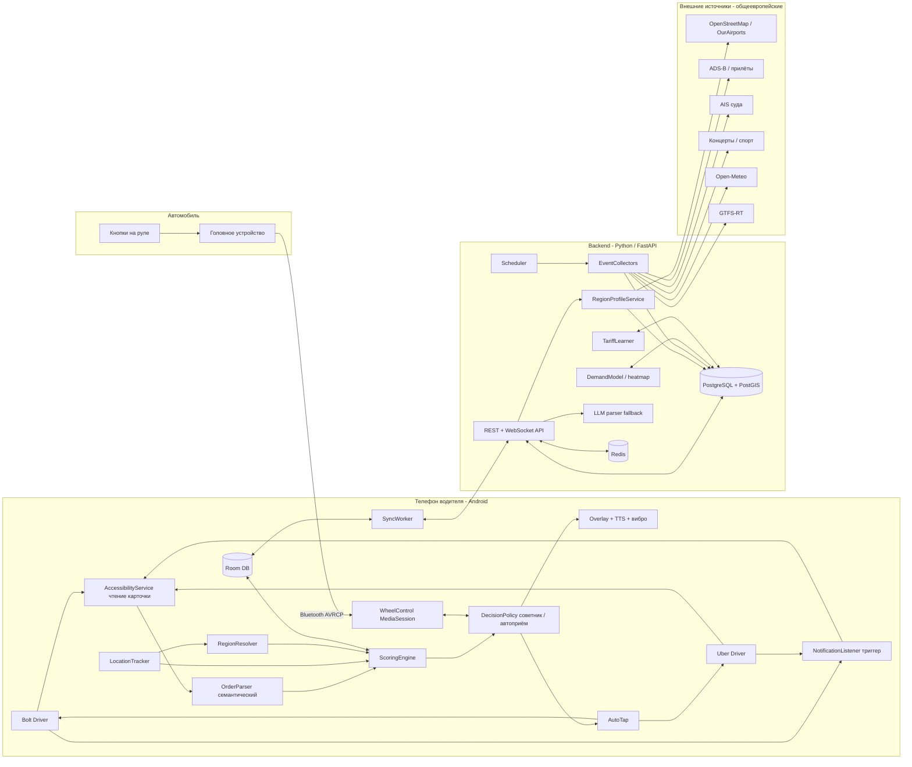
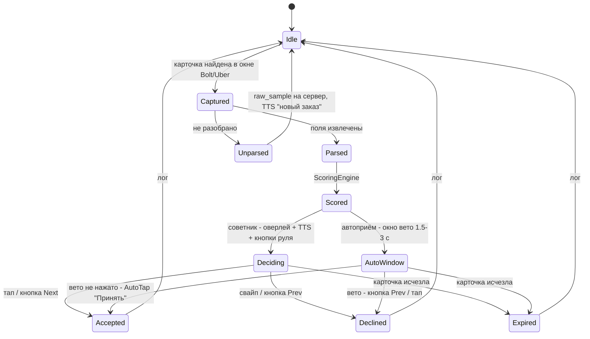

# TaxiPilot — помощник таксиста. Архитектура

Документ описывает целевую структуру системы: Android-приложение на телефоне водителя и серверную
часть (сбор событий, профили регионов, аналитика). Проект самостоятельный: Telegram-бот из этого
репозитория (`bot.py`) в него не входит и не изменяется.

Связанные документы:

- [order-capture-and-parsing.md](order-capture-and-parsing.md) — перехват карточки заказа Bolt/Uber, парсер, автоприём. Содержит разбор реальных образцов.
- [steering-wheel-control.md](steering-wheel-control.md) — управление приложением кнопками на руле (Bluetooth / AVRCP).

## 0. Исходные условия

Подтверждено заказчиком:

| # | Условие | Следствие для архитектуры |
|---|---------|---------------------------|
| C1 | Телефон водителя — **Android** (на скриншотах Samsung / One UI). | Перехват содержимого экрана через `AccessibilityService`, оверлеи, медиасессия — всё доступно. Отдельно учитываем агрессивное энергосбережение Samsung. |
| C2 | **Любой европейский город**, регион определяется по местоположению водителя. | Нет ручной настройки города. Модуль `core-region` строит профиль региона (валюта, аэропорты, порты, площадки, источники событий) автоматически; источники событий — в первую очередь общеевропейские, локальные адаптеры — как уточнение. |
| C3 | Режим **«советник» + опциональный автоприём** (вариант B). | `AccessibilityService` нужен в любом случае (для чтения карточки), автоприём — нажатие «Принять» тем же сервисом по политике водителя, с предохранителями. |
| C4 | Новый проект **с нуля**, бот не трогаем. | Отдельный репозиторий `taxipilot` (Android + backend). Этот репозиторий содержит только проектную документацию. |
| C5 | Получены 4 реальных карточки заказов (Bolt ×2, Uber ×2; RU и PL интерфейс; Труймясто, PLN). | Данные заказа живут в **карточке внутри приложения**, не в уведомлении. Парсер — семантический, не зависящий от языка интерфейса (см. отдельный документ). |

## 1. Цели и ключевые сценарии

1. **Заказ пришёл → решение за 2–3 секунды.** Карточка перехвачена из окна Bolt/Uber, распарсена,
   оценена; водителю озвучена рекомендация («Uber: 26 злотых, подача 2 минуты, 18 минут поездки — брать»)
   и показан оверлей. Подтверждение — тап, кнопка на руле или автоприём по политике.
2. **Где быть через 30–60 минут.** Приложение знает прилёты, швартовку паромов и круизных судов,
   окончания концертов и матчей, погоду, сбои транспорта — и подсказывает, куда ехать, с учётом позиции.
3. **Смена как единое целое.** Заработок, время, простой; целевой доход в час в местной валюте; разбор смены.
4. **Руки на руле.** Все критичные действия доступны без касания экрана: голос (TTS) + кнопки руля.
5. **Новый город без настройки.** Водитель приехал в другой город/страну — через минуту приложение знает
   местные аэропорты, порты, стадионы и валюту.

## 2. Общая архитектура



Принцип разделения: **всё, что влияет на решение по заказу в реальном времени, считается на телефоне
офлайн** (перехват, парсинг, скоринг, политика, озвучка, кнопки руля, автотап). Сервер готовит данные
заранее (профиль региона, события, тепловая карта, тарифная модель) и отдаёт их пакетами; потеря связи
не ломает основной сценарий.

## 3. Android-приложение (Kotlin)

### 3.1 Модули

| Модуль | Назначение | Ключевые технологии |
|--------|-----------|---------------------|
| `core-capture` | Перехват карточки заказа. **Основной путь:** `AccessibilityService` читает дерево окна Bolt Driver (`ee.mtakso.driver`) / Uber Driver (`com.ubercab.driver`) при событиях изменения окна, находит карточку по якорям (кнопка «Принять» в любом языке + цена) и отдаёт упорядоченный список текстов. **Триггер:** `NotificationListenerService` ловит уведомление «новый заказ» и форсирует немедленное чтение окна. **Резерв:** `MediaProjection` + ML Kit OCR, если карточка отрисована без текстовых узлов. Детали — в [order-capture-and-parsing.md](order-capture-and-parsing.md). | `AccessibilityService`, `NotificationListenerService`, ML Kit |
| `core-parser` | Семантический парсер: не зависит от языка интерфейса, опирается на форму данных (цена с валютой, пары «минуты • км», рейтинг, адреса) и на многоязычные словари тегов/квалификаторов. Выход — `OrderOffer`. Неразобранное → `raw_samples` на сервер, LLM-разбор, выпуск правила. | Kotlin, тесты на реальных образцах |
| `core-region` | Определяет регион по GPS: страна, валюта, часовой пояс, язык(и); запрашивает/кеширует `RegionProfile` с сервера (аэропорты, порты, площадки, тарифная модель, активные источники событий). Пересчёт при смещении > 30 км или смене страны. Офлайн-минимум: страна и валюта из встроенного набора полигонов. | Bundled GeoJSON стран, `FusedLocationProvider` |
| `core-scoring` | Оценка заказа (раздел 4). Полностью офлайн, цель < 100 мс. | чистый Kotlin |
| `feature-decision` | `DecisionPolicy` (советник / автоприём с условиями), оверлей поверх Bolt/Uber (`SYSTEM_ALERT_WINDOW`) с вердиктом и цифрами, TTS, вибропаттерн; окно решения с таймаутом; приём подтверждения с экрана, руля или от политики. | `WindowManager`, `TextToSpeech`, `Vibrator` |
| `feature-autotap` | Нажатие «Принять»/«Отклонить» в окне Bolt/Uber через тот же `AccessibilityService`. Используется (а) после явного действия водителя (кнопка руля), (б) в режиме автоприёма — по политике. Предохранители: см. отдельный документ, раздел 6. | `AccessibilityNodeInfo.performAction`, `dispatchGesture` |
| `feature-wheel` | Управление кнопками на руле — [steering-wheel-control.md](steering-wheel-control.md). | `MediaSessionCompat`, `AudioFocus`, ExoPlayer |
| `feature-events` | Лента событий и карта: прилёты, суда, концерты, матчи; рекомендация «куда ехать» на горизонте 15/30/60 минут; пуши о «волнах». | MapLibre, `WorkManager` |
| `feature-shift` | Смена: старт/стоп, GPS-трек, учёт заказов (принятые/отклонённые/выполненные), факт vs цель, перерывы. | `FusedLocationProvider`, foreground service |
| `feature-settings` | Целевой доход в час (в валюте региона), дом и время окончания смены, пороги, режим решения и правила автоприёма, комиссии платформ (для нормализации цен), раскладка кнопок руля, язык озвучки. | `DataStore` |
| `feature-onboarding` | Пошаговая выдача разрешений (Accessibility, уведомления, оверлей, батарея) с инструкциями по производителю (Samsung: «Никогда не переводить в спящий режим»). | — |
| `data-local` | Room: `orders`, `decisions`, `events`, `venues`, `heatmap_cells`, `shift_log`, `raw_samples`, `region_profiles`. | Room |
| `data-remote` | Клиент API, синхронизация пачками (профиль региона, события на 24 ч, тепловая карта, правила парсера, коэффициенты). | Ktor, `WorkManager` |
| `service-foreground` | Единый foreground-сервис (типы `location` + `mediaPlayback`); watchdog; защита от убийства системой. | Foreground service |

### 3.2 Жизненный цикл заказа



### 3.3 Модель данных `OrderOffer`

```kotlin
data class OrderOffer(
    val id: String,                  // хэш (платформа, цена, адреса) — дедупликация повторных событий окна
    val platform: Platform,          // BOLT | UBER
    val product: String?,            // "Bolt", "UberX", "UberX Priority", "Comfort"…
    val capturedAt: Instant,
    val price: Money,                // как показано на карточке
    val priceBasis: PriceBasis,      // NET_AFTER_COMMISSION | GROSS_BEFORE_COMMISSION | UNKNOWN
    val priceNet: Money,             // нормализовано к «на руки» по настройкам комиссий
    val ratePerKm: Money?,           // Uber показывает "≈3,35 PLN/км"
    val bonus: Money?,               // "+4,59 zł за приоритет"
    val pickupEtaMin: Int?, val pickupKm: Double?, val pickupAddress: String?,
    val tripEtaMin: Int?,   val tripKm: Double?,   val dropoffAddress: String?,
    val pickupGeo: LatLng?, val dropoffGeo: LatLng?,   // геокодирование локально (кеш) / на сервере
    val riderName: String?, val riderRating: Double?,
    val tags: Set<OfferTag>,         // CASH, OUT_OF_RANGE, SCHEDULED, EXCLUSIVE, PRIORITY, NO_PENALTY_DECLINE
    val uiLocale: String?,           // "ru", "pl" — определено по словарю
    val rawLines: List<String>,
    val ruleId: String?,
)
```

## 4. Оценка заказа (ScoringEngine)

Базовая метрика — **ожидаемый доход в час «на руки» за полный цикл**, в валюте региона:

```
cycle_min   = pickup_eta + trip_eta + reposition_min(dropoff_zone, time)
net         = normalize(price, priceBasis, platform_commission, vat, fleet_cut) + bonus
per_hour    = net / cycle_min * 60

score = per_hour
      * zone_factor(dropoff_zone, eta_at_dropoff)     // спрос в зоне прибытия по тепловой карте
      * event_factor(dropoff_geo, eta_at_dropoff)     // рядом заканчивается матч / волна прилётов / швартовка
      * home_factor(dropoff_geo, shift_end)           // в конце смены ценим направление к дому
      * risk_factor(rider_rating, tags, pickup_km)    // риск отмены / неоплаты / пустой обратной
```

Жёсткие правила (срабатывают до формулы, настраиваемы):

| Правило | Пример из образцов | Действие по умолчанию |
|---------|--------------------|-----------------------|
| `OUT_OF_RANGE` и подача > N мин | Bolt: подача 45 мин / 45.7 км, поездка 10 мин за 16,70 zł | **Пропустить** |
| `CASH` | Bolt: «Оплата наличными» | По предпочтению водителя (нейтрально / штраф / запрет) |
| `SCHEDULED` | Bolt: тег с часами | Отдельный поток: озвучить время, не считать как обычный заказ |
| Подача > M км при цене < K | Bolt: 16 мин подача ради 1.9 км за 8,93 zł | **Пропустить** |
| Рейтинг пассажира < R | — | Понизить score на коэффициент |
| Простой > X минут | — | Порог снижается, чтобы не стоять |

Вердикт:

- `score >= target * 1.1` → **Брать**; `target * 0.8 … 1.1` → **На усмотрение**; ниже → **Пропустить**.
- Пример (Uber Priority: 26,46 zł нетто, подача 2 мин, поездка 18 мин, репозиционирование из Kolbudy ≈ 12 мин):
  `26.46 / 32 * 60 ≈ 49.6 zł/ч` → при цели 40 zł/ч — **Брать**.
- Пример (Uber X: 9,54 zł, подача 4, поездка 7, репозиционирование ≈ 3): `9.54 / 14 * 60 ≈ 40.9 zł/ч` — **на усмотрение**, но если цена указана до комиссии, после нормализации (−25…30 %) → ≈ 30 zł/ч — **Пропустить**. Поэтому `priceBasis` и настройка комиссий критичны.

**Тарифная модель региона** (`TariffLearner` на сервере): регрессия `price ~ a + b·trip_km + c·trip_min` по
залогированным предложениям в данном городе и платформе. Нужна для (а) заказов без цены, (б) оценки
`reposition_min` и обратной поездки, (в) выявления аномально дорогих/дешёвых предложений (сурж).
Работает в любом городе без ручной настройки, стартует с общеевропейских значений по умолчанию.

Все коэффициенты — в JSON-конфиге с сервера, кешируются. Каждое решение и исход логируются для калибровки.

## 5. Backend (Python 3.12, FastAPI)

### 5.1 Сервисы

| Сервис | Назначение |
|--------|-----------|
| `api` | REST + WebSocket: аутентификация (телефон → JWT), выдача профиля региона, событий, тепловой карты, конфигов скоринга и правил парсера; приём логов решений и `raw_samples`. |
| `region` | `RegionProfileService`: по координате строит и кеширует профиль региона (раздел 5.2). Первый водитель в новом городе инициирует сборку профиля; далее — обновление раз в сутки. |
| `collectors` | Сборщики событий по активным регионам (где есть хотя бы один водитель за последние 7 дней). Каждый источник — адаптер `fetch(region) -> list[Event]`. Расписание — APScheduler. |
| `demand` | Тепловая карта спроса по гексам H3 (разрешение 8) × час недели: история предложений/заказов водителей региона + вклад событий. |
| `tariff` | `TariffLearner` — тарифные модели по (регион, платформа). |
| `parser-llm` | Разбор неизвестных карточек через LLM, генерация кандидата правила, полуавтоматическое утверждение. |
| `notify` | Push (FCM) о волнах и рекомендациях; опционально — новый Telegram-канал уведомлений (отдельный бот, не связанный с `bot.py`). |

Хранилище: PostgreSQL + PostGIS, Redis (кеш, pub/sub для WebSocket).

### 5.2 Профиль региона: автоматическое обнаружение

```
RegionProfile {
  country_code, currency, timezone, languages,
  city_name, center, bbox,
  airports[]   : OurAirports (type large/medium, ≤ 80 км) + OSM aeroway=aerodrome
  ports[]      : OSM harbour / ferry_terminal / cruise terminal (≤ 40 км), AIS-геозона на подходе
  rail_hubs[]  : OSM railway=station с usage=main / international
  venues[]     : OSM leisure=stadium, amenity=events_venue/theatre, building=arena, capacity>=3000;
                 плюс площадки из Ticketmaster/PredictHQ по bbox
  event_sources[]: какие адаптеры активны (есть ли GTFS-RT, какие API покрывают страну)
  tariff_defaults: стартовая тарифная модель
  commission_defaults: типичные комиссии Bolt/Uber в стране (переопределяются водителем)
}
```

Источники событий, ранжированные по универсальности (сначала то, что работает в любой стране ЕС):

| Категория | Универсальный источник | Что даёт | Локальные уточнения (пример: Труймясто) |
|-----------|------------------------|----------|-----------------------------------------|
| Прилёты | **OpenSky Network** (ADS-B, бесплатно): борта в геозоне аэропорта со снижением → факт посадки; AeroDataBox / FlightAware AeroAPI по ICAO — расписание и тип ВС | время посадки, вместимость → пассажиропоток в +25…40 мин | GDN (EPGD), терминал T2 |
| Суда и паромы | **AIS через aisstream.io** (бесплатный WebSocket): пассажирские суда (тип 60–69) с ETA в геозону порта | швартовка пассажирского/круизного судна, размер судна | Stena Line Гдыня–Карлскруна, Polferries Гданьск–Нюнесхамн, круизный терминал Гдыня; расписания операторов — опциональные адаптеры |
| Поезда / автобусы | GTFS (статика) из Mobility Database; GTFS-RT где есть | прибытие дальних поездов, задержки | PKP Portal Pasażera; Gdańsk Główny, Gdynia Główna |
| Концерты, спорт | **PredictHQ** (оценка посещаемости, вся Европа), **Ticketmaster Discovery API** (большинство стран ЕС), Bandsintown/Songkick (концерты), football-data.org / API-Football (матчи с площадкой) | площадка, старт, ожид. длительность, аудитория | Polsat Plus Arena Gdańsk, Ergo Arena, Open'er (Гдыня-Косаково), Stadion Miejski Gdynia; парсинг eBilet/going. — опционально |
| Погода | Open-Meteo | дождь, снег, похолодание | — |
| Транспорт | GTFS-RT алерты (где есть) | закрытие линий, замены | ZTM Gdańsk / ZKM Gdynia, SKM |
| Праздники / массовые даты | Nager.Date (гос. праздники по стране), календарь региона из PredictHQ | профили дня, перекрытия | Jarmark Dominikański, марафоны |

Единая сущность `Event`:

```
id, region_id, kind (FLIGHT|SHIP|TRAIN|CONCERT|SPORT|WEATHER|TRANSIT|HOLIDAY),
title, venue_id, geo (point), starts_at, ends_at (ожид.), ends_confirmed_at,
expected_people, confidence, source, source_ref, updated_at
```

`Venue`: id, region_id, name, geo, тип, типовая «точка посадки», средняя задержка выхода, вместимость, источник.

### 5.3 Рекомендация «куда ехать»

Каждые 5 минут (или по запросу) для позиции водителя считается набор кандидатов:
`value(venue, t) = expected_people(t) * take_rate / competing_drivers_est − travel_cost(pos → venue)`.
Топ-3 с временем выезда. Пуш — только если лучший кандидат заметно лучше текущей позиции (гистерезис).

## 6. Модель данных (сервер)

- `drivers` — id, телефон, настройки (цель/час, дом, комиссии платформ, режим решения), текущий `region_id`.
- `regions`, `region_profiles` — см. 5.2; версия профиля для инвалидации кеша на телефоне.
- `orders` — распарсенные предложения (без персональных данных пассажиров), решение, исход.
- `raw_samples` — нераспознанные карточки (маскированные) для выпуска правил.
- `parser_rules` — platform, версия, словари, якоря, тесты-примеры, статус.
- `events`, `venues` — см. выше.
- `heatmap_cells` — region_id, h3_index, dow, hour, demand_score.
- `tariff_models` — region_id, platform, коэффициенты, качество, дата.
- `shifts`, `shift_points` — смены и GPS-трек (с прореживанием).
- `scoring_configs` — версии коэффициентов, персональные переопределения.

## 7. Риски и ограничения

| Риск | Смягчение |
|------|-----------|
| Нарушение ToS Bolt/Uber (чтение экрана, автоприём) | Советник по умолчанию; автоприём — явный опт-ин с предупреждением; человекоподобные задержки и лимиты; кнопка-стоп на руле; мгновенное отключение по флагу с сервера, если платформа начнёт детектировать. |
| Google Play не пропустит `AccessibilityService` для этой цели | Распространение собственным APK (сайт + автообновление) — закладывается с самого начала. |
| Bolt/Uber меняют вёрстку карточки | Парсер опирается на форму данных, а не на позиции элементов; правила обновляются с сервера; алерт при росте доли `Unparsed`; LLM-fallback. |
| Карточка без текстовых узлов (Canvas/Flutter-рендер) | Резервный OCR-путь; проверить на первом же прототипе на реальном телефоне. |
| Samsung/Xiaomi убивают сервис | Foreground-сервис, онбординг с отключением оптимизации, watchdog, `MediaButtonReceiver` как точка воскрешения. |
| Батарея | Адаптивный GPS, медиасессия только в окне решения, чтение окна только по событиям. |
| Платные API событий | Бесплатное ядро (OpenSky, aisstream, Open-Meteo, Nager.Date, OSM, GTFS); PredictHQ/AeroDataBox — по мере пользы, на регион включаются отдельно. |
| Персональные данные пассажиров | На сервер — только обезличенные поля; имена и телефоны маскируются на телефоне до отправки `raw_samples`. |
| Новая страна без тарифных данных | Общеевропейские значения по умолчанию, тарифная модель обучается с первых 30–50 предложений. |

## 8. Структура нового репозитория `taxipilot`

```
taxipilot/
├── android/
│   ├── app/
│   ├── core-capture/ core-parser/ core-region/ core-scoring/
│   ├── feature-decision/ feature-autotap/ feature-wheel/ feature-events/ feature-shift/
│   ├── feature-settings/ feature-onboarding/
│   ├── data-local/ data-remote/ service-foreground/
│   └── testdata/order-cards/        # реальные карточки как фикстуры парсера
├── backend/
│   ├── app/api/ app/region/ app/collectors/ app/demand/ app/tariff/ app/parser_llm/ app/notify/
│   ├── migrations/ (alembic)
│   └── tests/
├── docs/                            # эти документы переезжают сюда
└── infra/                           # docker-compose, деплой
```

## 9. Этапы реализации

1. **Проверка перехвата на реальном телефоне.** Прототип `AccessibilityService`: дамп дерева окна Bolt/Uber при появлении карточки. Выясняем, есть ли текстовые узлы и resource-id. Это главный технический риск — снимаем первым.
2. **Парсер на реальных образцах.** Семантические правила + словари RU/PL/EN, фикстуры из скриншотов, тесты.
3. **Скоринг + советник.** Оверлей, TTS, лог решений, настройка комиссий и цели/час. Приложение полезно уже на этом этапе без сервера.
4. **Кнопки на руле.** Модуль `feature-wheel`.
5. **Автоприём.** `feature-autotap`, политика, окно вето, предохранители.
6. **Backend минимум + регион.** Авторизация, `RegionProfileService` на OSM/OurAirports, синхронизация логов, правила парсера с сервера, LLM-fallback.
7. **События: прилёты (OpenSky), суда (AIS), погода.** Универсальные источники, лента событий, рекомендация «куда ехать».
8. **События: концерты, спорт, транспорт, праздники.** PredictHQ/Ticketmaster/football-data, GTFS-RT.
9. **Тепловая карта и тарифные модели.** Калибровка по исходам, персональные коэффициенты.

## 10. Открытые вопросы

1. Марка/год автомобиля и магнитолы — для проверки AVRCP и вывода карточки на дисплей.
2. Тег Bolt с иконкой часов «Срок» (первый скриншот): это запланированный заказ (`SCHEDULED`) или что-то иное?
3. Какие комиссии у вас фактически по Bolt и Uber (и есть ли партнёр-флот с собственной долей)? Нужны для нормализации цен «на руки».
4. Целевой доход в час в злотых, с которого начнём калибровку порогов.
