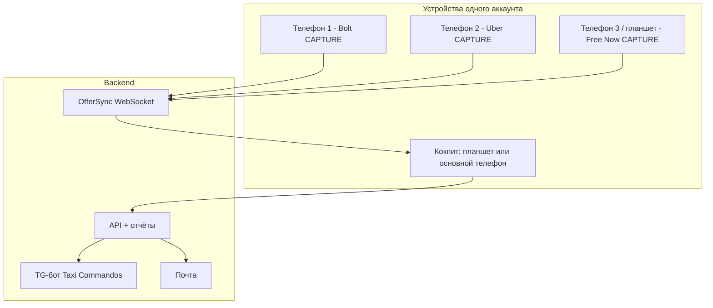
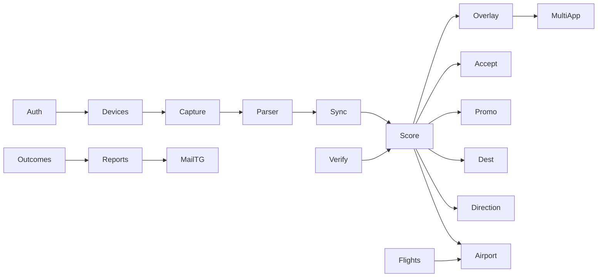

# Декомпозиция функций и задач Taxi Commandos

Полный перечень функций и задач реализации. Архитектура — [architecture.md](architecture.md).
Этот документ — рабочий план: эпики → функции → задачи, зависимости, волна внедрения.

Подтверждено дополнительно (C11–C15):

| # | Условие | Следствие |
|---|---------|-----------|
| C11 | Водители работают на **2 телефонах**, на **3 при Free Now**; часть использует **планшет**. | Не «одно приложение на одном телефоне». Связка устройств одного аккаунта: CAPTURE на каждом телефоне с платформой, COCKPIT (решения, руль, сводка) — на выбранном устройстве, часто планшет. |
| C12 | **Free Now** — полноценная третья платформа. | Те же capture/parser/скоринг/принятие/отмены/акции, что Bolt и Uber. |
| C13 | **Очередь аэропорта — только у Uber.** | Советник очереди читает Uber; Bolt/Free Now в очередь не ставятся. Оптимизация ожидания — по прилётам. |
| C14 | Приоритеты **A и B внедряются сразу**, не «потом». | Волны 0–4 закрывают ядро + A + B + графические отчёты + e-mail/Telegram. |
| C15 | Сводная информация и отчёты — **графически**, отправка на **e-mail и в Telegram**. | Дашборд на кокпите; доставка через сервер (новый TG-бот Taxi Commandos `@taxicom_bot`, не `bot.py`). |
| C16 | Название **Taxi Commandos**, домен **taxicom.app**. | Пакет `app.taxicom.commandos`, API `api.taxicom.app`, почта `*@taxicom.app`. |

Роли устройства (настраиваются при онбординге, меняются в любой момент):

| Роль | Что делает | Типично |
|------|------------|---------|
| `CAPTURE` | Accessibility + уведомления + (опц.) снимок карты спроса той платформы, что установлена здесь; шлёт офферы в аккаунт < 200 мс | телефон с Bolt / Uber / Free Now |
| `COCKPIT` | Оверлей решения, TTS, кнопки руля, дашборд смены, «Еду к…», план, отчёты | планшет на торпедо или телефон, подключённый к BT машины |
| `BOTH` | Capture + кокпит на одном устройстве | один телефон (редкий случай) |
| `VIEWER` | Только дашборд и отчёты, без захвата | второй планшет / старый телефон |

Оффер с CAPTURE-устройства публикуется в `account_offers` (WebSocket). Кокпит считает скоринг (у него GPS, настройки, поле спроса) и шлёт решение обратно: `ACCEPT`/`DECLINE`/`IGNORE` → CAPTURE выполняет автотап на «своей» платформе. Если кокпит недоступен 800 мс — CAPTURE считает скоринг локально (те же конфиги из профиля) и решает сам.

---

## Волны внедрения

| Волна | Содержание | Результат |
|-------|------------|-----------|
| **W0** | Репозиторий, auth, устройства, захват+парсер Bolt/Uber/**Free Now**, сырой лог карточек | Видим заказы с трёх платформ на трёх устройствах в одном аккаунте |
| **W1** | Скоринг, советник, автоприём, multi-app координатор, синхронизация офферов, кокпит | Решение за 2–3 с по всем платформам, без двойного accept |
| **W2** | Принятие, отмены/no-show, акции/Бонус+, зоны спроса, проверка маршрутов, «Еду к…» | Ядро оценки + A2/A3 + часть B |
| **W3** | Аэропорт Uber + прилёты, план смены, расходы/топливо/налоги, безопасность, Free Now-специфика, ритуалы SNR | A4/A5 + весь B |
| **W4** | Дашборд, графические отчёты, e-mail, Telegram | Сводка «как поработал» и доставка |
| **W5** | События (суда, спорт, транспорт), тепловая карта, обучение моделей, калибровка | Серверное усиление, не блокирует ценность W0–W4 |

Задачи помечены `Wn` и `P0/P1` (блокер волны / можно параллелить).

---

## Эпик E0. Фундамент

### F0.1 Репозиторий и инфраструктура
- T0.1.1 Монорепо `taxicom`: `android/`, `backend/`, `docs/`, CI (lint, unit, instrumented на эмуляторе). W0 P0
- T0.1.2 Docker-compose: PostgreSQL+PostGIS, Redis, backend, worker. W0 P0
- T0.1.3 Окружения: dev / staging / prod; секреты не в git. W0 P0
- T0.1.4 Канал распространения APK (свой хостинг + in-app обновление); Play Store не цель. W0 P1

### F0.2 Auth и аккаунт
- T0.2.1 Регистрация e-mail+пароль, Argon2id, verify-email, forgot/reset. W0 P0
- T0.2.2 JWT access 15 мин + ротация refresh, Keystore на устройстве. W0 P0
- T0.2.3 Список устройств, «выйти везде», удаление аккаунта (GDPR). W0 P0
- T0.2.4 Офлайн-сессия 30 дней. W0 P1

### F0.3 Связка устройств
- T0.3.1 Привязка устройства к аккаунту: имя, модель, роль (CAPTURE/COCKPIT/BOTH/VIEWER), установленные платформы. W0 P0
- T0.3.2 WebSocket `account_bus`: офферы, решения, состояние «в поездке», GPS кокпита, настройки. Цель < 200 мс в 4G. W0 P0
- T0.3.3 Локальный fallback скоринга на CAPTURE, если кокпит молчит 800 мс. W0 P0
- T0.3.4 Конфликт двух кокпитов: один active (последний с BT / явный выбор). W0 P1
- T0.3.5 Планшет: layout кокпита (крупные цифры, ландшафт), без обязательного Accessibility, если роль VIEWER/COCKPIT без capture. W0 P0
- T0.3.6 Онбординг «у вас 2 телефона»: QR «добавить устройство», какой телефон = какая платформа. W0 P0

---

## Эпик E1. Захват и разбор заказов

Платформы: **Bolt** (`ee.mtakso.driver`), **Uber** (`com.ubercab.driver`), **Free Now** (пакет уточнить на устройстве, якоря — кнопка принятия + цена).

### F1.1 Accessibility + уведомления
- T1.1.1 `NotificationListenerService` как триггер «новый заказ» по пакетам трёх платформ. W0 P0
- T1.1.2 `AccessibilityService`: события окна, якоря карточки (ACCEPT_LABELS + цена), выделение поддерева, дедуп по id. W0 P0
- T1.1.3 Состояние «в поездке» / «ожидание» / «Arrived» / «очередь аэропорта Uber» по якорям окон. W0 P0
- T1.1.4 Резерв OCR (`MediaProjection` + ML Kit), если нет текстовых узлов — решение после дампа на реальном телефоне. W0 P1
- T1.1.5 Дампы деревьев реальных карточек Bolt/Uber/Free Now (RU/PL) → фикстуры. W0 P0

### F1.2 Семантический парсер
- T1.2.1 Экстракторы: цена+валюта, пары мин/км, рейтинг, адреса, продукт. W0 P0
- T1.2.2 Словари тегов и кнопок PL/RU/EN/UK, доставка с сервера. W0 P0
- T1.2.3 `priceBasis` по платформе: Bolt=net, Uber=gross−variable fee, **Free Now** — по факту карточки (проверить на образцах; заложить таблицу). W0 P0
- T1.2.4 Теги: CASH, OUT_OF_RANGE, SCHEDULED, EXCLUSIVE, PRIORITY, NO_PENALTY_DECLINE, оранжевая рамка Bolt (optional order). W0 P0
- T1.2.5 Free Now: отличия карточки (цена, комиссия, cash, XL), якоря «Akceptuj». W0 P0
- T1.2.6 Неразобранное → `raw_samples` (маскированные) → LLM-кандидат правила. W1 P1
- T1.2.7 Юнит-тесты на всех фикстурах; CI ломается при регрессе. W0 P0

### F1.3 Автотап
- T1.3.1 Click / gesture по узлу Принять/Отклонить/X; человекоподобные задержки. W1 P0
- T1.3.2 Выполнение решения, пришедшего с кокпита, на CAPTURE-устройстве платформы. W1 P0
- T1.3.3 Предохранители: выкл по умолчанию, стоп с руля, пауза в поездке, серверный флаг. W1 P0
- T1.3.4 Запрет Decline-тапа в поездке (acceptance-rate). W2 P0

---

## Эпик E2. Оценка заказа

### F2.1 Нормализация цены
- T2.1.1 Bolt: `net = price`. W1 P0
- T2.1.2 Uber: `net = price × (1 − fee_est)`; `FeeLearner` со стартом 25 % + VAT. W1 P0
- T2.1.3 Free Now: `net` по `priceBasis` + комиссия флота. W1 P0
- T2.1.4 Комиссия флота, VAT — из настроек. W1 P0
- T2.1.5 Чтение экрана «поездка завершена» / выписка → факты выплат. W2 P1

### F2.2 Ставки и индекс E
- T2.2.1 `R_km`, `R_h` с подачей; геометрическое `E`; медианы региона/daypart. W1 P0
- T2.2.2 Длинные поездки: круг pickup+trip+return, `long_trip_km`, `return_weight`, пол `R_km_long`. W1 P0
- T2.2.3 Ночные правила и ночной референс. W1 P0
- T2.2.4 Адаптивный порог `E*` от потока λ; пол себестоимости `c_km`. W1 P0
- T2.2.5 Жёсткие правила: OUT_OF_RANGE, короткая поездка с длинной подачей, SCHEDULED-поток. W1 P0
- T2.2.6 Офлайн-роутер H3 для return_km (`core-routing`). W1 P1

### F2.3 Надстройки к net (подключаются по мере готовности модулей, контракт один)
- T2.3.1 `+ marginal_bonus` акций. W2
- T2.3.2 `+ dest_bonus` (сурж, события, посадки). W2
- T2.3.3 `+ direction_factor` («Еду к…»). W2
- T2.3.4 `− acceptance_cost`, `− cancellation_cost`. W2
- T2.3.5 Эффективные км/мин после проверки маршрута / bias. W2

---

## Эпик E3. Решение и кокпит

### F3.1 Оверлей и TTS
- T3.1.1 Оверлей поверх любой платформы / на кокпите: вердикт, цена, подача, E, R_km, R_h, причина (бонус / зона / направление). W1 P0
- T3.1.2 Двухфазный вердикт (карточка → уточнение после verify). W2 P1
- T3.1.3 TTS + вибро; ночная короткая форма; языки PL/RU/EN/UK. W1 P0
- T3.1.4 Политика Advisor / Auto + вето 1.5–3 с. W1 P0

### F3.2 Координатор multi-app и multi-device
- T3.2.1 Слияние офферов с устройств аккаунта, окно 3 с «ждём вторую карточку». W1 P0
- T3.2.2 Выбор лучшего по `net_eff`/`E`; остальные — IGNORE или бесплатный отказ. W1 P0
- T3.2.3 Блок двойного accept: после ACCEPT на одной платформе остальные закрываются. W1 P0
- T3.2.4 Приоритет при равном E: акция / худший acceptance / лучшая факт-комиссия. W1 P1
- T3.2.5 Оверлей «два заказа»: обе карточки рядом, крупно на планшете. W1 P0

### F3.3 Кнопки руля
- T3.3.1 MediaSession + тихий поток, захват в окне решения. W1 P1
- T3.3.2 Раскладка Next/Prev/Play, жесты, вето, стоп автоприёма. W1 P1
- T3.3.3 HFP-кнопка «голос» + SpeechRecognizer; SCO TTS для Prius 20. W1 P1
- T3.3.4 Профили магнитол + «Тест кнопок»; BT-пульт. W1 P1
- T3.3.5 В поездке Prev = IGNORE. W2 P0
- T3.3.6 Метаданные заказа на дисплее магнитолы. W1 P1

---

## Эпик E4. Показатели платформ

### F4.1 Принятие (acceptance)
- T4.1.1 Исход IGNORED; таблица «что засчитывается» × платформа × состояние (Bolt/Uber/**Free Now**). W2 P0
- T4.1.2 Тихий игнор невыгодных в поездке; запрет Decline-тапа. W2 P0
- T4.1.3 Счётчик по окну (Bolt официально 100; Uber exclusive 100; Free Now — уточнить чтением экрана). W2 P0
- T4.1.4 Чтение значения с экрана статистики; автопроверка таблицы. W2 P0
- T4.1.5 Алерты 60/55/50 % + «акция под угрозой»; гистерезис. W2 P0
- T4.1.6 Режим «берегу показатель» + `acceptance_cost`. W2 P0
- T4.1.7 Trip Radar Uber не в знаменатель; оранжевая рамка Bolt = бесплатный отказ. W2 P0

### F4.2 Отмены и no-show
- T4.2.1 Счётчик cancellation, алерты 5/8/10 %. W2 P0
- T4.2.2 Таймер 5:00 после Arrived (≤150 м Bolt; пороги Uber/Free Now из доков/дампа). W2 P0
- T4.2.3 Чеклист fee; TTS на 4:30; автотап «клиент не вышел». W2 P0
- T4.2.4 Cash: шаблон в Support. W2 P1
- T4.2.5 `cancellation_cost` при отмене уже принятого. W2 P1

---

## Эпик E5. Проверка маршрута

- T5.1 Интерфейс `RoutingProvider`; Google Routes `computeRouteMatrix` TRAFFIC_AWARE. W2 P0
- T5.2 Двухфазный вердикт, timeout 1.5 с, один вызов на pickup/trip/return. W2 P0
- T5.3 Фильтры бюджета, кеш H3×корзина трафика, резерв длинных. W2 P0
- T5.4 Серверный прокси + BYOK. W2 P1
- T5.5 `PlatformBiasModel`. W2 P1
- T5.6 Пометки расхождения в оверлее; автоприём только после verify. W2 P0
- T5.7 Навигация к подаче (Google/Waze/Yanosik) по тем же координатам. W2 P1
- T5.8 Mapbox/HERE/TomTom как подключаемые. W5 P1

---

## Эпик E6. Зоны спроса и события назначения

- T6.1 Сурж из карточек vs тарифная модель. W2 P0
- T6.2 Парсинг push «wysoki popyt». W2 P1
- T6.3 Снимки карты ожидания Bolt/Uber/Free Now + HSV/OCR + привязка (подписи/маркер/движение). W2 P1
- T6.4 Поле сообщества, затухание τ, пакет каждые 60 с. W2 P1
- T6.5 `dest_bonus`: сурж, отток с концерта/матча, посадки 15–20 мин, суда, база. W2 P0
- T6.6 Калибровка EV_next по факту следующего заказа. W5 P1
- T6.7 Рекомендация «куда ехать» по EV_next. W2 P1

---

## Эпик E7. Акции

- T7.1 Парсер экранов Quest / Odkrywaj Boost+ / Kampanie / **акции Free Now**. W2 P0
- T7.2 Push акций; community для региональных (не персональный Quest). W2 P1
- T7.3 Ручной ввод и голос. W2 P1
- T7.4 Прогресс по outcomes; сверка с экраном доходов. W2 P0
- T7.5 `marginal_bonus`, `P_complete`, `decline_cost`. W2 P0
- T7.6 Boost+ пропорционально времени; зона в «куда ехать». W2 P1
- T7.7 Авто- и ручной Бонус+. W2 P0
- T7.8 Планировщик недели. W2 P1

---

## Эпик E8. Направление, аэропорт, смена, расходы, безопасность (A+B)

### F8.1 «Еду к…»
- T8.1.1 Цель (дом / точка / событие / аэропорт к волне), Flexible/Faster. W2 P0
- T8.1.2 `direction_factor` в скоринге, кросс-платформенно. W2 P0
- T8.1.3 Напоминание включить штатный Uber Destination Mode, если сессия доступна. W3 P1
- T8.1.4 Ритуал Stop New Requests до/после поездки (B2). W3 P0

### F8.2 Аэропорт — только Uber + прилёты
- T8.2.1 Детектор геозоны аэропорта и экрана очереди **Uber** (позиция/ETR с экрана). W3 P0
- T8.2.2 Волны посадок: OpenSky/ADS-B, выход пассажиров +25…40 мин, окно «сели за 15–20 мин». W3 P0
- T8.2.3 Решение: **встать в очередь / подождать вне лота / взять городской к аэропорту / уехать**.
  Сравнение: `wait_cost = ETR_uber × (ожид. zł/ч в городе)` vs `EV` заказа из волны.
  «Вставайте в 21:40 — три борта садятся 21:55–22:05, выход ~22:25, очередь сейчас 18 мин.» W3 P0
- T8.2.4 Алерт «волна слабая, ETR 40 мин — в городе выгоднее»; «волна через 12 мин — не уезжайте». W3 P0
- T8.2.5 Сообщество ETR (водители Uber в лоте, обезличено). W3 P1
- T8.2.6 **Не** строить очередь Bolt/Free Now; Free Now FastPass — не реализовывать (очередь только Uber). W3 P0
- T8.2.7 Заказ «в аэропорт» в скоринге: dest_bonus с волной минус стоимость простоя в лоте, если очередь длинная. W3 P0

### F8.3 План смены
- T8.3.1 Прогноз R_h по часам: своя история × регион × события × погода × акции. W3 P0
- T8.3.2 Подбор окон под «хочу N часов». W3 P1
- T8.3.3 Push «пора выходить» за 30 мин. W3 P0
- T8.3.4 Чеклист старта/конца смены (B2). W3 P0

### F8.4 Расходы и налоги (B1)
- T8.4.1 Пресеты расхода авто (Prius/Corolla/…) × км × цена топлива. W3 P0
- T8.4.2 Ручной/community ввод цены АЗС; карта АЗС по пути. W3 P1
- T8.4.3 `profit = net − fuel − fleet − estimated_tax`. W3 P0
- T8.4.4 Недельный CSV/KPiR бухгалтеру на e-mail. W4 P0

### F8.5 Безопасность (B4)
- T8.5.1 SOS: 112 + шаринг гео доверенному контакту; жест на руле. W3 P0
- T8.5.2 Ночной усиленный cash/рейтинг; озвучка адреса до принятия. W3 P0
- T8.5.3 Локальный блок-лист (хэш имени, не на сервер). W3 P1
- T8.5.4 Подсказка «не просите пассажира отменить». W3 P1

### F8.6 Цепочки и тупики (B3)
- T8.6.1 После принятия: «после высадки рядом зона ×1.4». W3 P1
- T8.6.2 Предупреждение «высадка в тупик», если отказ ещё дешёвый. W3 P1

---

## Эпик E9. Сводная графика, отчёты, e-mail, Telegram

### F9.1 Живой дашборд кокпита (во время смены)
Экран / виджет / AoD — читается за 1 секунду глазами, не таблица:

- T9.1.1 **Шапка смены:** net (оценочно/подтверждено), profit, онлайн, zł/ч, zł/км, utilization — крупные цифры. W4 P0
- T9.1.2 **Светофор платформ:** Bolt / Uber / Free Now — принятие %, отмены %, «в поездке / ждёт», последняя карточка. W4 P0
- T9.1.3 **Часовая лента сегодня** (столбцы net, цвет = zł/ч vs медиана; точки офферов). Тап → час. W4 P0
- T9.1.4 **Воронка решений:** увидено → принято / игнор в поездке / отказ / истекло — stacked bar. W4 P0
- T9.1.5 **Лента акций:** прогресс Quest/Kampania, Boost+ слот, Бонус+ вкл/выкл. W4 P0
- T9.1.6 **Карта смены:** трек, посадки/высадки, активный сурж, волна аэропорта (если в регионе). W4 P0
- T9.1.7 **Блок «сейчас»:** рекомендация куда ехать, ETR Uber-очереди если в геозоне, следующая посадка GDN. W4 P0
- T9.1.8 Ландшафт планшета — основная раскладка; портрет телефона — компакт. W4 P0

### F9.2 Отчёт за час / сутки / смену / неделю
- T9.2.1 Агрегатор офлайн на каждом устройстве + серверная сверка (уже в reports.md). W4 P0
- T9.2.2 Графики: лента часов, pie платформ, гистограмма E, траектория acceptance/cancellation, длинные vs короткие, ночь vs день, dest_bonus hit-rate, честность платформ (карточка/карты/факт). W4 P0
- T9.2.3 Инсайты 3–5 строк. W4 P0
- T9.2.4 Сравнение с 7 днями и медианой региона. W4 P1
- T9.2.5 Снимок настроек дня; profit после топлива/флота. W4 P0

### F9.3 Доставка
- T9.3.1 PDF дня (графики растром + цифры) на устройстве и на сервере. W4 P0
- T9.3.2 CSV часов и заказов. W4 P0
- T9.3.3 **E-mail:** конец смены / утро / понедельник; шаблон PL/RU/EN; вложения PDF+CSV; адрес из профиля + доп. (бухгалтер). W4 P0
- T9.3.4 **Telegram:** отдельный бот `@taxicom_bot` (не `bot.py`): `/start` + привязка chat_id к аккаунту по одноразовому коду из приложения; сводка текстом + картинка ленты; команда `/report вчера|неделя`. W4 P0
- T9.3.5 Настройки: куда слать (e-mail / TG / оба), когда, язык, включать ли адреса в CSV. W4 P0
- T9.3.6 Озвучка конца смены 20 с — уже в reports; остаётся. W4 P1

---

## Эпик E10. Регион, события, обучение (W5, не блокирует продукт)

- T10.1 RegionProfile: OSM/OurAirports, валюта, площадки. W0 минимум (страна+валюта офлайн); полный — W5
- T10.2 Коллекторы: OpenSky (нужен уже в W3 для аэропорта), AIS, PredictHQ/Ticketmaster/football, Open-Meteo, GTFS-RT, Nager.Date. W3/W5
- T10.3 TariffLearner, FeeLearner, медианы E, калибровка dest/surge/α. W5
- T10.4 LLM-правила парсера. W5
- T10.5 Каталог HeadUnitProfile, краудсорсинг. W5

---

## Эпик E11. Настройки, онбординг, качество

- T11.1 Все экраны каталога architecture.md 4.7 + Multi-app/устройства, Еду к…, Отмены, Аэропорт, План, Расходы, Безопасность, Отчёты (доставка). W1–W4
- T11.2 Живой пример «как изменился бы вердикт». W1 P1
- T11.3 Онбординг разрешений по роли устройства + Samsung battery. W0 P0
- T11.4 Телеметрия качества: unparsed %, latency capture→verdict, WS lag устройств, доля IGNORED. W1 P1
- T11.5 Полевые чек-листы: дамп карточек трёх платформ; 30 снимков карты спроса; неделя сверки acceptance; тест руля на Prius; 50 сверок маршрутов. W0–W3

---

## Сводка задач по волнам (для планирования)

| Волна | Задач P0 (оценка порядка) | Задач P1 |
|-------|---------------------------|----------|
| W0 фундамент + захват 3 платформ + устройства | ~22 | ~6 |
| W1 скоринг + кокпит + multi-app + руль | ~20 | ~8 |
| W2 принятие/отмены + акции + спрос + маршруты + «Еду к…» | ~28 | ~12 |
| W3 аэропорт Uber+прилёты + план + B-расходы/безопасность/ритуалы | ~18 | ~10 |
| W4 дашборд + отчёты + e-mail + TG | ~16 | ~4 |
| W5 обучение и расширенные события | по мере данных | — |

Порядок внутри волны — по зависимостям: auth/устройства → capture/parser → sync → scoring → overlay → координатор; параллельно руль и настройки. A и B не вынесены «на потом»: A1–A5 и B1–B4 имеют задачи в W1–W3, B-отчёты/налоги — W4.

## Зависимости, которые нельзя нарушить

