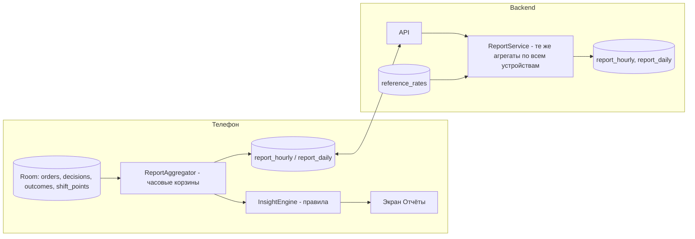

# Отчёты: за сутки и по часам по всем заказам

Модуль `feature-reports` (Android) и сервис `reports` (backend). Общая архитектура — в
[architecture.md](architecture.md); метрики заказа (`net`, `R_km`, `R_h`, `E`) — там же, раздел 4.

## 1. Зачем

Цель приложения — максимизировать доход, и отчёт должен отвечать на вопросы водителя:
«сколько я заработал за час в каждый час», «сколько заказов видел, сколько взял, сколько пропустил и
правильно ли», «в какие часы и где было лучше всего», «что принесли подсказки по событиям». Поэтому
отчёт строится **по всем предложениям**, а не только по выполненным поездкам: отклонённые и
истёкшие — такие же данные, как принятые.

## 2. Источники данных

| Источник | Что даёт |
|----------|----------|
| `orders` (все карточки) | платформа, продукт, цена, `net_est`, подача/поездка (км, мин), теги, `R_km`, `R_h`, `E`, `E*` в момент предложения, `λ` |
| `decisions` | вердикт советника, действие (принят / отклонён / истёк), канал (экран / руль / голос / автоприём / вето), задержка реакции |
| `outcomes` | факт: поездка состоялась / отменена пассажиром / отменена водителем; фактическая выплата и комиссия (`fee_observations`), когда известны |
| `shift_points` | GPS-трек → километраж, скорость, простой, пройдено с пассажиром / без |
| Окна Bolt/Uber «в пути» | начало/конец подачи и поездки (из `AccessibilityService`) → фактические минуты подачи и поездки |
| `events`, рекомендации | какие волны/события были активны и следовал ли им водитель |
| `reference_rates` | медианы региона для сравнения «я vs типичный водитель здесь» |

## 3. Метрики

### 3.1 Для каждого часового интервала (локальное время; смена, пересекающая полночь, не ломается)

| Группа | Метрика | Определение |
|--------|---------|-------------|
| Поток | `offers_total`, по платформам, по продуктам | карточек увидено |
| | `offers_per_hour_online` (λ) | `offers_total / online_min × 60` |
| | `unparsed` | карточек не разобрано |
| Решения | `accepted`, `declined_manual`, `declined_auto_policy`, `expired`, `auto_accepted`, `vetoed` | по `decisions` |
| | `acceptance_rate` | `accepted / offers_total` |
| | `median_reaction_ms` | время от карточки до действия, по каналам |
| Доход | `net_est_accepted` | сумма `net_est` принятых |
| | `net_actual` | сумма фактических выплат (если известны); иначе `null`, отчёт помечен «оценочно» |
| | `fee_actual_pct` (Uber) | факт комиссии по часу |
| | `tips` | если видны на экране выплат |
| Время | `online_min`, `busy_min` (подача + поездка), `idle_min`, `break_min` | из смены и окон Bolt/Uber |
| | `utilization` | `busy_min / online_min` |
| Пробег | `km_total`, `km_paid`, `km_pickup`, `km_deadhead` | GPS-трек, размеченный состояниями |
| | `paid_km_ratio` | `km_paid / km_total` |
| Ставки | `R_h_realized` | `net / online_min × 60` — реальный доход за час на линии |
| | `R_h_busy` | `net / busy_min × 60` |
| | `R_km_realized` | `net / km_total` |
| | `E_median_accepted`, `E_median_declined`, `E_star_median` | распределения индекса |
| Себестоимость | `cost_est` | `c_km × km_total` |
| | `profit_est` | `net − cost_est` |
| Упущенное | `best_declined` | топ-3 отклонённых по `E`, с указанием, был ли водитель в этот момент занят |
| | `missed_value_est` | сумма `net_est` отклонённых с `E ≥ E*`, пока водитель был свободен |
| Качество решений | `regret_accepted` | принятые с `E < E* × 0.9` (взяли слабое) |
| | `good_declines` | отклонённые с `E < E*`, за которыми в течение 15 мин пришёл принятый заказ с большим `E` |
| Длинные / ночные | `long_trips_accepted`, `long_trips_R_km_long_median`, `return_km_total` | длинные заказы (по настройке `long_trip_km`): сколько, какая цена километра круга, сколько км возврата фактически (по GPS) против оценки |
| | `is_night_hour`, `night_R_h_vs_region` | час попадает в ночной интервал настроек; реализованный доход за час против ночной медианы региона |
| Зоны спроса | `dest_bonus_decisions`, `surge_cells_seen`, `median_surge_at_pickup`, `next_order_after_min_hot_vs_normal` | решения, изменённые ценностью назначения; покрытие полем суржа; факт: через сколько пришёл следующий заказ после высадки в горячей зоне против обычной |
| Акции | `bonus_earned`, `bonus_per_trip`, `decisions_changed_by_bonus`, `bonus_mode_min`, `acceptance_rate_in_window` | бонусы акций за час, решения, изменённые режимом Бонус+, минуты в Бонус+, показатель принятия в окне акции |
| Проверка маршрута | `verified_offers`, `median_pickup_bias`, `median_trip_bias`, `verdicts_changed_by_verification`, `traffic_ratio_median` | сколько карточек проверено по картам, насколько платформы занижали/завышали, сколько вердиктов изменила проверка, плотность пробок |
| Контекст | `events_active` | активные события/волны в радиусе 3 км |
| | `followed_recommendation` | была ли рекомендация «куда ехать» и выполнена ли |
| | `region_median_R_h`, `region_median_R_km` | референс для сравнения |
| | `weather` | осадки/температура |

### 3.2 За сутки (и за смену — смена может быть частью суток или захватывать две даты)

Суммы и средние по часам плюс:

- `best_hour`, `worst_hour` по `R_h_realized`;
- `platform_split` — доля дохода и заказов Bolt / Uber; `fee_actual_avg` по Uber за день;
- `cash_share` — доля наличных;
- `distribution_E` — гистограмма `E` принятых и отклонённых (видно, насколько водитель следует советам);
- `advisor_agreement` — доля решений, совпавших с вердиктом; доход в часы с согласием vs без;
- `auto_accept_stats` — сколько автопринято, сколько вето, средний `E` автопринятых;
- `scheduled_orders` — предварительные заказы, увиденные и взятые;
- `top_pickup_zones`, `top_dropoff_zones` — гексы H3 с наибольшим числом принятых;
- `long_pickups` — принятые с подачей > 10 мин и их фактическая отдача;
- `compare_7d` — те же метрики vs среднее по последним 7 аналогичным дням недели;
- `compare_region` — `R_h_realized` vs медиана региона в те же часы.
- `night_summary` — отдельная сводка по ночным часам: доход, zł/ч против ночной медианы, доля длинных, фактический пустой возврат.
- `long_trip_summary` — все длинные заказы дня: оценка `R_km_long` при решении vs факт (реальный возврат по GPS, был ли обратный заказ) — калибрует `return_weight`.
- `destination_accuracy` — предсказанный `EV_next` против факта для заказов с `dest_bonus` и без; `surge_capture_coverage`.
- `promotions_summary` — акции дня: выполнено / не выполнено, обещано / получено, доход в час в окне акции против обычного.
- `platform_honesty` — таблица Bolt vs Uber: подача и поездка по карточке / по картам с трафиком / по факту (окна «в пути» + GPS); медианы и 90-й перцентиль расхождения.
- `settings_snapshot` — значения настроек (4.7 архитектуры), действовавшие в этот день; при изменении в середине дня — оба набора с временем.

### 3.3 Инсайты (правила, формулируются текстом)

Генератор на телефоне проходит по правилам и выдаёт 3–5 коротких выводов на день, например:

- «Лучший час — 17:00–18:00: 92 zł/ч при 9 предложениях. Худший — 14:00–15:00: 21 zł/ч, 12 мин простоя.»
- «Пропущено 6 заказов с E ≥ E* на сумму ≈ 84 zł, пока вы были свободны.»
- «Uber: фактическая комиссия сегодня 27,4 % против оценки 30,75 % — модель скорректирована.»
- «Два принятых заказа с подачей > 12 мин дали 1,1 zł/км — ниже себестоимости.»
- «В 21:40 была волна прилётов (5 рейсов), вы были в 4 км; заказ из аэропорта в 22:05 — лучший за день.»
- «Радио/источник: кнопки руля не использовались 3 часа подряд — проверьте источник Bluetooth.»
- «Проверка маршрута изменила 4 вердикта и сэкономила ≈ 35 минут подачи. Uber занижал подачу в 17–19 ч в среднем на 6 минут.»

Правила хранятся как конфиг (условие над метриками + шаблон текста RU/PL/EN), доставляются с сервера.

## 4. Формирование



- **На телефоне, офлайн.** Часовые агрегаты пересчитываются инкрементально: при закрытии каждого
  часа (`WorkManager`, точный будильник на начало часа + при завершении смены) и при поступлении новых
  фактов (выплата появилась — пересчёт затронутого часа и дня). Отчёт доступен без сети сразу.
- **На сервере** — та же логика (общий модуль расчёта описан спецификацией, тесты на одних фикстурах),
  нужна для сравнения с регионом, нескольких устройств и долгой истории. Телефон отправляет сырые
  события; сервер считает и отдаёт обратно `compare_region`, `compare_7d`.
- **Оценочно vs подтверждено.** Пока по часу нет фактов выплат, доход показывается как «≈» с пометкой.
  Когда `FeeLearner` получает факты, час помечается «подтверждено». Дневной отчёт показывает долю подтверждённого.
- **Смена vs сутки.** Отчёт за сутки — «отчётные сутки» с границей из настроек (по умолчанию 04:00–04:00 локального времени региона, чтобы ночная смена не резалась полуночью). Отчёт за смену — от
  «начал смену» до «закончил». Оба доступны; по умолчанию утром показывается вчерашняя смена.

## 5. Представление

### 5.1 Экран «Отчёты»

- Выбор дня (календарь с индикатором дохода на каждом дне), переключатель «сутки / смена».
- Сводка дня: `net`, `profit_est`, `R_h_realized`, `online`, `accepted/offers`, стрелки сравнения с 7 днями и регионом.
- **Часовая лента**: 24 столбца — высота = `net`, цвет = `R_h_realized` относительно медианы региона
  (зелёный / жёлтый / красный), серые сегменты — офлайн, штриховка — простой. Под лентой — ряд точек:
  предложения (принятые — закрашенные, отклонённые — пустые, размер = `E`).
- Тап по часу → детали часа: таблица метрик, список всех карточек часа с `E`, вердиктом, действием,
  исходом, фактической выплатой; подсветка `best_declined` и `regret_accepted`.
- Блок «Инсайты».
- Карта дня: трек, точки посадки/высадки, активные события в это время.

### 5.2 Автоматические сводки

| Когда | Что | Канал |
|-------|-----|-------|
| Конец смены | 20-секундная озвучка: доход, часов, zł/ч, лучший час, один главный инсайт | TTS + уведомление |
| 08:00 следующего дня (если смена закончилась после 22:00 — 10:00) | Карточка «Вчера» с тремя цифрами и ссылкой на отчёт | Push |
| Понедельник 09:00 | Неделя: 7 дней рядом, тренды | Push + e-mail (опционально) |

### 5.3 Экспорт

- CSV по часам и CSV по заказам за выбранный период (для флота / бухгалтера): все поля из раздела 3,
  без имён пассажиров.
- PDF дня (сводка + часовая лента + инсайты) через `PdfDocument` на телефоне — «поделиться».
- Сервер: `GET /reports/daily?from&to&format=csv|json`, `GET /reports/hourly?date`.

## 6. Модель данных

Телефон (Room) и сервер (PostgreSQL) используют одинаковую схему агрегатов:

```
report_hourly (
  driver_id, region_id, hour_start_local, tz,
  offers_total, offers_bolt, offers_uber, unparsed,
  accepted, declined_manual, declined_auto_policy, expired, auto_accepted, vetoed,
  net_est, net_actual, net_confirmed_ratio, tips, fee_actual_pct,
  online_min, busy_min, idle_min, break_min,
  km_total, km_paid, km_pickup, km_deadhead,
  r_h_realized, r_h_busy, r_km_realized,
  e_median_accepted, e_median_declined, e_star_median, lambda,
  cost_est, profit_est, missed_value_est, regret_accepted, good_declines,
  events_active_json, weather_json, computed_at, version
)
report_daily ( driver_id, date_local, ... суммы и производные из 3.2 ..., insights_json, computed_at, version )
```

`version` — версия алгоритма расчёта: при изменении формул старые дни пересчитываются фоном, чтобы
сравнения были честными.

Сырые таблицы, по которым всё считается, уже есть в архитектуре: `orders`, `decisions`, `outcomes`,
`fee_observations`, `shifts`, `shift_points`. Срок хранения сырых GPS-точек — 90 дней с прореживанием;
агрегаты — бессрочно.

## 7. API

| Метод | Назначение |
|-------|-----------|
| `GET /reports/daily?date=` | дневной отчёт с часами и инсайтами |
| `GET /reports/range?from=&to=` | список дневных сводок (календарь) |
| `GET /reports/hourly?date=&hour=` | детали часа со списком заказов |
| `GET /reports/export?from=&to=&kind=hours\|orders&format=csv` | экспорт |
| `POST /reports/recompute?date=` | принудительный пересчёт (после импорта выписки) |

Ответы кэшируются на телефоне; при расхождении локального и серверного расчёта (разные версии)
показывается локальный, в фоне подтягивается серверный.

## 8. Приватность

В отчётах нет имён пассажиров и точных адресов подачи/высадки — только гексы H3 (разрешение 8, ≈ 0,7 км²)
и названия районов. На сервер уходят те же обезличенные поля. Экспорт CSV содержит адреса только если
водитель явно включил это в настройках экспорта.

## 9. Тестирование

- Юнит-тесты агрегатора на синтетической смене: пересечение полуночи, перевод часов (DST), смена региона
  внутри дня, заказ без факта выплаты, поздний факт, отменённая поездка.
- Снэпшот-тесты инсайтов на фиксированных метриках.
- Сверка телефон ↔ сервер на одних фикстурах (JSON-набор смен в `testdata/shifts/`).
- UI-тест часовой ленты при 0 заказов, 1 заказе, 60 заказах.
