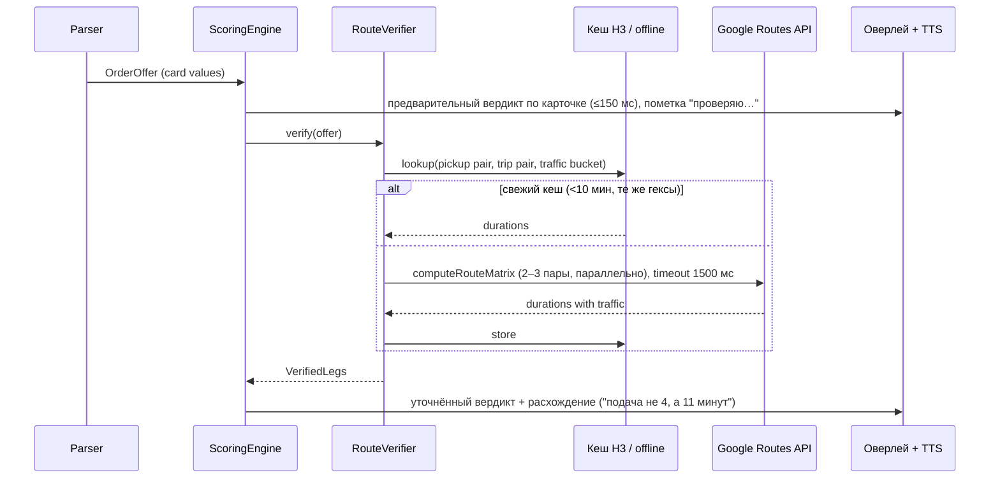

# Проверка расстояний и времени по картам с учётом пробок

Модуль `core-route-verify` (Android) + сервис `routing-proxy` (backend). Общая архитектура — в
[architecture.md](architecture.md); скоринг, который потребляет результат, — там же, раздел 4.

## 1. Зачем

Карточки Bolt и Uber показывают подачу и поездку в минутах и километрах, но эти цифры:

- считаются платформой на своих моделях, часто **без актуальных пробок** или с оптимистичным
  прогнозом (вечерний пик, перекрытия, мосты через Мотлаву, Обводница в Труймясто);
- для подачи — от **точки, которую платформа считает позицией водителя**, а не от фактической;
- округляются («4 мин», «2 мин»), а для поездки могут не учитывать, что пассажиру «6,6 км» — это
  через центр в 17:30.

Ошибка в 5 минут подачи на 11-минутном заказе меняет `R_h` в полтора раза. Поэтому приложение
**пересчитывает оба отрезка (и возврат для длинных поездок) по внешнему роутеру с трафиком в реальном
времени** и подставляет в скоринг проверенные значения, а расхождения показывает водителю и копит
в отчётах как «честность платформы».

## 2. Что проверяем

Для каждого предложения `OrderOffer`:

| Отрезок | Откуда | Куда | Источник точек |
|---------|--------|------|----------------|
| Подача | фактическая GPS-позиция водителя сейчас | адрес подачи | GPS телефона; адрес из карточки (строка) |
| Поездка | адрес подачи | адрес высадки | обе строки из карточки |
| Возврат (только для длинных, 4.2a) | адрес высадки | исходная точка (настройка) | — |

Результат по отрезку: `distance_m`, `duration_s` (с трафиком на момент выезда), `duration_no_traffic_s`,
`traffic_ratio = duration / duration_no_traffic`, `confidence` (адрес геокодирован однозначно / неоднозначно),
`provider`, `fetched_at`.

Время выезда для расчёта: подача — «сейчас»; поездка — «сейчас + подача»; возврат — «сейчас + подача +
поездка». Так учитывается, что пробка через 20 минут будет другой.

## 3. Провайдеры

Модуль абстрагирован интерфейсом `RoutingProvider`; Google — основной, остальные подключаемы.

| Провайдер | API | Трафик в реальном времени | Адреса строкой | Цена (ориентир, проверять актуальный прайс) | Примечания |
|-----------|-----|---------------------------|----------------|--------------------------------------------|------------|
| **Google Maps Platform** | Routes API `computeRoutes` (`routingPreference: TRAFFIC_AWARE_OPTIMAL`, `departureTime`), `computeRouteMatrix` для нескольких пар | да, лучший охват в Европе | да, `waypoint.address` — геокодирование внутри вызова, без отдельного Geocoding API | уровень Pro (traffic-aware) порядка 10 USD / 1000 запросов, есть бесплатная месячная квота на SKU | Нужен ключ с ограничением по Android-пакету и SHA-1 либо серверный прокси. Условия: результаты нельзя кешировать дольше ограничений ToS (координаты — до 30 дней, маршруты — только для текущей сессии), атрибуция Google в UI там, где показываем данные |
| Mapbox | Directions API `driving-traffic` | да | нет (нужен Geocoding) | ~2 USD / 1000 после 100 000 бесплатных в месяц | Хороший fallback по цене |
| HERE | Routing v8, `departureTime`, traffic | да | нет (Geocoding отдельно) | бесплатно 30 000/мес, далее ~1 USD/1000 | Сильный в DACH |
| TomTom | Routing API + Traffic | да | нет | бесплатно 2 500/день | — |
| Собственный OSRM/Valhalla (`core-routing`) | матрица гексов H3 из кеша | **нет** (только исторические профили по часам) | нет | бесплатно | Офлайн-резерв: если провайдер недоступен, превышен бюджет или нет сети |

Выбор провайдера, ключ и бюджет — настройки водителя (раздел 8). Серверный прокси позволяет флоту
выдать один ключ на всех и держать квоту.

## 4. Как это вписывается в окно решения

Бюджет времени: карточка живёт 8–15 с, вердикт нужен за ~2 с. Поэтому:



- **Двухфазный вердикт.** Сначала — мгновенный по карточке. Если проверка вернулась и меняет
  вердикт — оверлей и TTS обновляются («Поправка: подача 11 минут. Пропустить.»). Если не меняет —
  тихо уточняются цифры. Если не успела за 1,5 с — остаётся вердикт по карточке с пометкой «не проверено»,
  результат всё равно сохраняется для отчётов.
- **Автоприём** ждёт проверку до конца окна вето (2 с) и принимает решение по проверенным данным;
  если проверка не успела — применяется настройка `auto_require_verification` (по умолчанию: да,
  без проверки автоприём не срабатывает, заказ переходит в режим советника).
- **Один сетевой вызов** на все отрезки (`computeRouteMatrix` с 2–3 парами origin/destination) — экономит и
  время, и деньги.

## 5. Экономия вызовов

Проверять каждую карточку необязательно. Порядок фильтров (все пороги — настройки):

1. Заказ уже отклонён жёстким правилом (себестоимость, вне радиуса) → **не проверяем**.
2. Подача ≤ `verify_min_pickup_min` (по умолчанию 3 мин) **и** поездка ≤ `verify_min_trip_km` (3 км) →
   не проверяем: ошибка на таких величинах мала.
3. Кеш: пары гексов H3 (разрешение 9, ≈ 0,1 км²) × «корзина трафика» (10 минут) — если есть свежее
   значение, используем без вызова. В одном районе за вечер подачи повторяются.
4. Дневной бюджет `verify_daily_budget` (по умолчанию 150 вызовов ≈ 1,5 USD/день на Google Pro;
   водитель видит расход в настройках). При исчерпании — переходим на коррекцию по модели смещения
   (раздел 6) и офлайн-роутер.
5. Длинные поездки проверяются **всегда** (там цена ошибки максимальна), даже вне бюджета — отдельный
   резерв `verify_long_trip_reserve` (20 вызовов/день).

При серверном прокси те же правила применяются на сервере + общий кеш по региону для всех водителей:
подача «от Галереи Балтыцкой до Вжеща в 18:10» уже посчитана кем-то минуту назад.

## 6. Модель смещения платформ (`PlatformBiasModel`)

Каждая проверка даёт пару (значение карточки, проверенное значение). Накопленные пары по
(платформа, регион, daypart, день недели, дальность) дают **систематическую поправку**:

```
bias_pickup(platform, region, daypart, dist_bucket) = median(verified_min / card_min)
bias_trip(...)                                      = median(verified_min / card_min)
```

Применение:

- Когда проверка не выполнялась (бюджет, нет сети, не прошло фильтр) — скоринг использует
  `card_min × bias` вместо голого значения карточки. Это бесплатное улучшение на каждом заказе.
- Когда проверка выполнена — используется проверенное значение, а пара пополняет модель.
- Модель считается на телефоне по своим данным и на сервере по всем водителям региона; серверная
  приходит пакетом как значение по умолчанию для нового города.

Ожидаемая картина (гипотеза, проверяется данными): Uber в пик занижает подачу на 20–40 %, Bolt
точнее по подаче, но округляет поездку вниз; ночью оба близки к правде. Отчёты покажут реальность.

## 7. Использование в скоринге

```
pickup_min_eff = verified ? pickup_verified_min : card_pickup_min × bias_pickup
trip_min_eff   = verified ? trip_verified_min   : card_trip_min   × bias_trip
pickup_km_eff  = verified ? pickup_verified_km  : card_pickup_km          // км платформы обычно честные
trip_km_eff    = verified ? trip_verified_km    : card_trip_km
return_*       = verified (для длинных) : из core-routing

R_h   = net / (pickup_min_eff + trip_min_eff [+ return_min_eff × return_weight]) × 60
R_km  = net / (pickup_km_eff + trip_km_eff [+ return_km_eff × return_weight])
```

Дополнительно:

- `traffic_factor`: если `traffic_ratio` на поездке > 1.4 (стоим в пробке), небольшой штраф к `E`
  (0.95) — время в пробке утомляет и повышает риск отмены пассажиром; настраиваемо.
- `discrepancy_flag`: если подача по проверке длиннее карточной более чем на `discrepancy_alert_pct`
  (по умолчанию 40 %) **и** на ≥ 3 мин — оверлей показывает красную пометку «Подача: 4 → 11 мин», TTS
  произносит поправку. Если платформа, наоборот, завысила — зелёная пометка (приятный сюрприз).
- Для Uber `ratePerKm` на карточке («≈3,35 PLN/км») пересчитывается на проверенные километры и
  показывается рядом: «3,35 → 2,9 PLN/км».

## 8. Настройки (добавляются в экран «Проверка маршрута» панели настроек, см. architecture.md 4.7)

| Параметр | Ключ | По умолчанию | Диапазон / тип |
|----------|------|--------------|----------------|
| Проверять маршруты по картам | `verify_enabled` | выкл (включается после ввода ключа или выбора прокси) | вкл/выкл |
| Провайдер | `verify_provider` | Google | Google / Mapbox / HERE / TomTom / только офлайн |
| Способ доступа | `verify_key_mode` | через сервер TaxiPilot | через сервер / собственный ключ (хранится в Keystore) |
| Собственный API-ключ | `verify_api_key` | — | строка, с проверкой тестовым запросом |
| Дневной бюджет вызовов | `verify_daily_budget` | 150 | 0–2000 |
| Резерв для длинных поездок | `verify_long_trip_reserve` | 20 | 0–200 |
| Не проверять, если подача ≤ | `verify_min_pickup_min` | 3 мин | 0–15 |
| Не проверять, если поездка ≤ | `verify_min_trip_km` | 3 км | 0–20 |
| Таймаут проверки | `verify_timeout_ms` | 1500 | 500–4000 |
| Автоприём только по проверенным данным | `auto_require_verification` | да | вкл/выкл |
| Порог предупреждения о расхождении | `discrepancy_alert_pct` | 40 % | 10–100 |
| Штраф за пробку от коэффициента | `traffic_penalty_from_ratio` | 1.4 | 1.1–3.0 (выкл) |
| Использовать модель смещения без проверки | `bias_correction_enabled` | да | вкл/выкл |
| Срок кеша маршрутов | `verify_cache_ttl_min` | 10 мин | 5–30 |
| Показывать расход бюджета в оверлее | `verify_show_budget` | нет | — |

Экран показывает: вызовов сегодня / бюджет, ориентировочную стоимость, медианное время ответа,
долю проверок, изменивших вердикт, и текущие значения смещения по платформам («Uber занижает
подачу в среднем на 28 % в 16–19 ч в вашем регионе»).

## 9. Безопасность ключей и условия использования

- **Серверный прокси (рекомендуется).** Ключ Google хранится только на сервере; приложение
  обращается к `POST /routing/verify` с JWT; сервер применяет квоту на водителя, общий кеш региона и
  правила из раздела 5. Расходы контролируются централизованно, ключ не утекает из APK.
- **Собственный ключ.** Для водителей-одиночек и флотов со своим биллингом: ключ ограничивается в
  Google Cloud по Android-пакету + SHA-1 и по API (только Routes), хранится в Android Keystore, в
  логи не попадает.
- **Условия Google Maps Platform.** Данные маршрутов не хранятся дольше сессии (кеш 10 мин укладывается),
  координаты геокодирования — до 30 дней; там, где цифры показаны водителю, присутствует атрибуция
  «Google» (мелко в оверлее и на экране заказа). Для Mapbox/HERE/TomTom — аналогичные требования своих ToS.
- Адреса пассажиров уходят провайдеру маршрутов — это неизбежно для проверки; в настройках явно
  написано, и провайдер выбирается водителем. На сервер TaxiPilot в логи уходят только гексы.

## 10. Данные и отчёты

Таблица `route_checks` (телефон + сервер, обезличено до гексов):

```
order_id, leg (PICKUP|TRIP|RETURN), card_min, card_km, verified_min, verified_km,
no_traffic_min, traffic_ratio, provider, from_h3, to_h3, departure_at, latency_ms,
changed_verdict (bool), fetched_at
```

Таблица `platform_bias` — агрегаты модели смещения по (platform, region, daypart, dow, dist_bucket).

В [reports.md](reports.md) добавляются:

- по часам: `verified_offers`, `median_pickup_bias`, `median_trip_bias`, `verdicts_changed_by_verification`,
  `traffic_ratio_median`;
- за сутки: «честность платформ» — таблица Bolt vs Uber: карточка / проверено / **факт** (фактические
  минуты подачи и поездки из окон «в пути» Bolt/Uber и GPS) — трёхсторонняя сверка, которая показывает,
  кто ближе к правде: платформа или карты;
- инсайты: «Проверка маршрута изменила 4 вердикта сегодня и сэкономила ≈ 35 минут подачи»,
  «Uber занижал подачу в 17–19 ч в среднем на 6 минут».

## 11. После принятия: навигация

Проверенный маршрут не пропадает: по кнопке руля «длинное NEXT» или автоматически (настройка
`navigate_on_accept`) приложение открывает навигацию к подаче в выбранном приложении
(Google Maps `google.navigation:q=lat,lng`, Waze `waze://?ll=…&navigate=yes`, Yanosik для Польши) — с теми
же координатами, что использовались в проверке, без повторного геокодирования.

## 12. Тестирование

- Юнит: фильтры бюджета, кеш по гексам и корзинам трафика, слияние card/verified/bias, смена вердикта.
- Контрактные тесты провайдеров на записанных ответах (`testdata/routes/*.json`), включая неоднозначный адрес,
  таймаут, ошибку квоты.
- Полевой: 50 реальных карточек из Труймясто с фиксацией карточка / Google / факт — первичная оценка
  смещения и проверка, что проверка укладывается в 1,5 с на мобильной сети.
