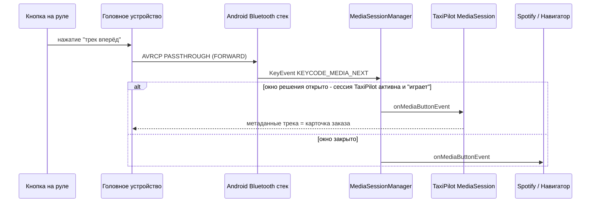
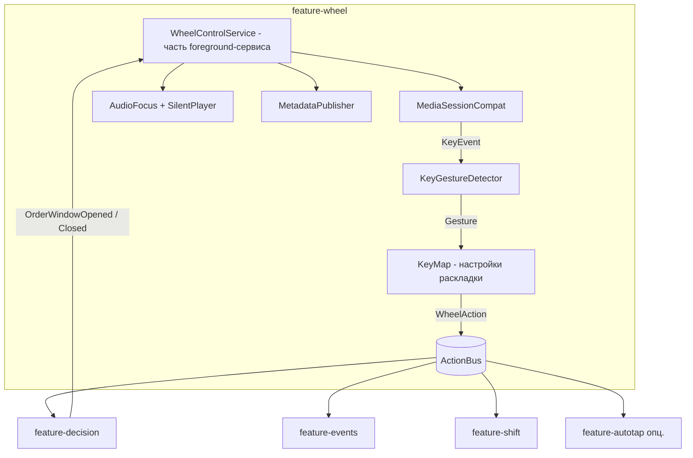
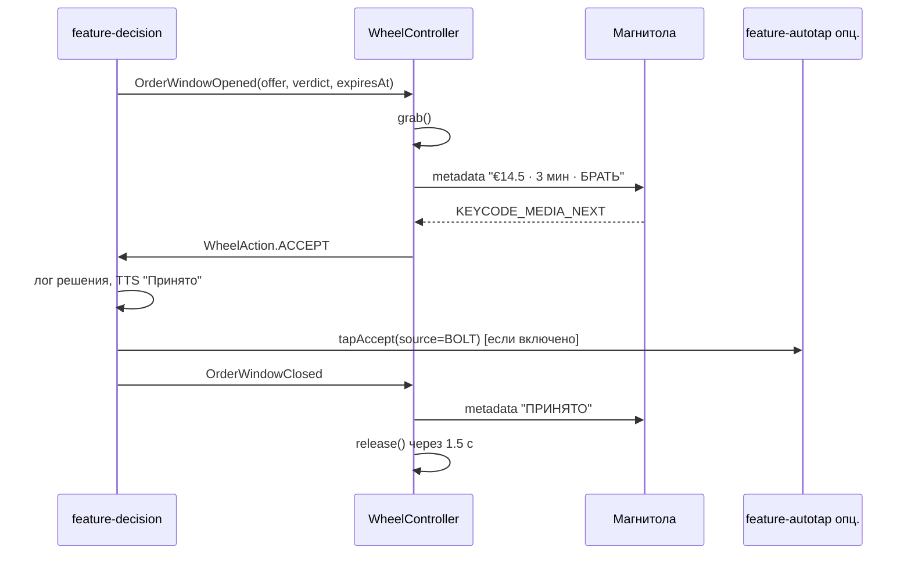

# Управление приложением кнопками на руле (Bluetooth)

Модуль `feature-wheel` Android-приложения. Позволяет водителю подтверждать/отклонять заказ,
повторять озвучку и выполнять другие действия, не касаясь экрана, — кнопками на руле,
которые в автомобиле отвечают за управление мультимедиа (трек вперёд/назад, play/pause).

Общая архитектура системы — в [architecture.md](architecture.md).

## 1. Как кнопки руля доходят до приложения



Ключевые факты, на которых строится модуль:

1. Кнопки руля подключены к **головному устройству**, а не к телефону. Магнитола транслирует их на
   телефон по профилю **Bluetooth AVRCP** как команды `PASSTHROUGH`. Android превращает их в обычные
   `KeyEvent` с кодами `KEYCODE_MEDIA_NEXT`, `KEYCODE_MEDIA_PREVIOUS`, `KEYCODE_MEDIA_PLAY_PAUSE`
   (иногда раздельно `PLAY` / `PAUSE` / `STOP`, а также `HEADSETHOOK`, `MEDIA_SKIP_FORWARD/BACKWARD`).
2. Android доставляет медиакнопки **одному** приложению — владельцу «последней активной играющей»
   `MediaSession`. Чтобы получать нажатия, нужно в нужный момент стать такой сессией.
3. Кнопки громкости и кнопки телефона (принять/отбой вызова, профиль HFP) до приложения
   **не доходят**: громкость обрабатывает магнитола сама, звонки — системный Telecom. Опираться можно
   только на медиакнопки.
4. Многие магнитолы показывают на дисплее/приборной панели **метаданные текущего трека**
   (`MediaMetadata`: название, исполнитель, альбом). Это бесплатный HUD: туда можно вывести карточку заказа.

## 2. Режимы работы

| Режим | Когда сессия активна | Что получает Spotify/навигатор | Для кого |
|-------|----------------------|-------------------------------|----------|
| **Окно решения** (по умолчанию) | Только пока открыто окно `Deciding` (пришёл заказ, таймер не истёк). После решения сессия отпускается и музыка возвращается. | Пауза/приглушение на 5–20 с во время заказа | Водители, которые слушают музыку/подкасты |
| **Постоянный** | Всегда, пока идёт смена | Ничего не получает — медиакнопки полностью у TaxiPilot | Водители без музыки; хотят кнопками листать события, повторять рекомендацию и т.п. |
| **Выключен** | Никогда | Всё | Нет кнопок на руле / машина без BT |

Переключение — в настройках и быстрым тумблером в уведомлении foreground-сервиса.

## 3. Раскладка кнопок

Раскладка настраиваемая; значения по умолчанию:

### 3.1 В окне решения (заказ на экране)

| Жест | Действие | Обратная связь |
|------|----------|----------------|
| `NEXT` короткое | **Принять** рекомендацию: подсветить «Принять» на оверлее; если включён `feature-autotap` — нажать «Принять» в Bolt/Uber | TTS «Принято», 1 короткая вибрация, на дисплее магнитолы «ПРИНЯТО» |
| `PREVIOUS` короткое | **Отклонить**: скрыть оверлей, залогировать отказ; если включён автотап — нажать «Отклонить»/закрыть предложение | TTS «Пропускаем», 2 короткие |
| `PLAY_PAUSE` короткое | **Повторить** озвучку заказа (цена, подача, направление, вердикт) | — |
| `PLAY_PAUSE` двойное | Озвучить **детали**: адреса, рейтинг пассажира, способ оплаты, что рядом с точкой высадки (событие/волна) | — |
| `NEXT` длинное (> 600 мс) | Принять **и** сразу построить маршрут к подаче в навигаторе (intent в Waze/Google Maps) | TTS «Принято, веду» |
| `PREVIOUS` длинное | Отклонить и включить **«тихий час»**: не озвучивать заказы ниже порога следующие 10 минут | TTS «Тихий режим 10 минут» |

### 3.2 Вне окна решения (только в постоянном режиме)

| Жест | Действие |
|------|----------|
| `PLAY_PAUSE` короткое | Озвучить текущую рекомендацию «куда ехать» и ближайшую волну |
| `NEXT` / `PREVIOUS` короткое | Следующее / предыдущее событие в ленте (озвучивается, выводится на дисплей магнитолы) |
| `PLAY_PAUSE` длинное | Старт/стоп перерыва в смене |
| `PLAY_PAUSE` двойное | Озвучить статистику смены: заработано, €/час, заказов принято/отклонено |
| `NEXT` длинное | Построить маршрут к рекомендованной точке |

### 3.3 Почему именно так

- `NEXT` = «да/вперёд», `PREVIOUS` = «нет/назад» — интуитивно и совпадает с расположением кнопок
  на большинстве рулей (вверх/вправо — вперёд).
- Самое частое действие (повтор озвучки) — на самой заметной кнопке `PLAY_PAUSE`.
- Длинные нажатия — для действий с побочными эффектами (запуск навигации, режимы), чтобы
  случайное нажатие не наделало дел.

## 4. Устройство модуля



### 4.1 `WheelControlService`

Не отдельный сервис, а компонент единого foreground-сервиса приложения (тип
`mediaPlayback` добавляется к `location`). Отвечает за захват и освобождение медиасессии:

```kotlin
class WheelController(
    private val context: Context,
    private val audio: AudioManager,
    private val keyMap: KeyMap,
    private val bus: ActionBus,
) {
    private val session = MediaSessionCompat(context, "TaxiPilotWheel").apply {
        setCallback(object : MediaSessionCompat.Callback() {
            override fun onMediaButtonEvent(intent: Intent): Boolean {
                val event = intent.getParcelableExtra<KeyEvent>(Intent.EXTRA_KEY_EVENT) ?: return false
                return gestures.onKeyEvent(event)
            }
            // Часть магнитол шлёт не KeyEvent, а transport-команды — покрываем оба пути.
            override fun onSkipToNext() { gestures.onSynthetic(KeyEvent.KEYCODE_MEDIA_NEXT) }
            override fun onSkipToPrevious() { gestures.onSynthetic(KeyEvent.KEYCODE_MEDIA_PREVIOUS) }
            override fun onPlay() { gestures.onSynthetic(KeyEvent.KEYCODE_MEDIA_PLAY_PAUSE) }
            override fun onPause() { gestures.onSynthetic(KeyEvent.KEYCODE_MEDIA_PLAY_PAUSE) }
        })
    }
    private val gestures = KeyGestureDetector { gesture -> keyMap.resolve(gesture)?.let(bus::emit) }
    private val silent = SilentPlayer(context)
    private val focusRequest = AudioFocusRequest.Builder(AudioManager.AUDIOFOCUS_GAIN_TRANSIENT_MAY_DUCK)
        .setAudioAttributes(AudioAttributes.Builder()
            .setUsage(AudioAttributes.USAGE_ASSISTANCE_NAVIGATION_GUIDANCE)
            .setContentType(AudioAttributes.CONTENT_TYPE_SPEECH).build())
        .build()

    fun grab() {
        audio.requestAudioFocus(focusRequest)
        silent.start()                       // тихий поток делает сессию "играющей" для MediaSessionManager
        session.setPlaybackState(playingState())
        session.isActive = true
    }

    fun release() {
        session.setPlaybackState(stoppedState())
        session.isActive = false
        silent.stop()
        audio.abandonAudioFocusRequest(focusRequest)   // музыка водителя возобновляется
    }

    fun publish(card: WheelCard) = session.setMetadata(
        MediaMetadataCompat.Builder()
            .putString(MediaMetadataCompat.METADATA_KEY_TITLE, card.title)      // "€14.50 · подача 3 мин"
            .putString(MediaMetadataCompat.METADATA_KEY_ARTIST, card.subtitle)  // "→ Аэропорт T2B · БРАТЬ"
            .putString(MediaMetadataCompat.METADATA_KEY_ALBUM, card.footer)     // "Next=принять  Prev=нет"
            .build()
    )

    private fun playingState() = PlaybackStateCompat.Builder()
        .setActions(PlaybackStateCompat.ACTION_PLAY or PlaybackStateCompat.ACTION_PAUSE
            or PlaybackStateCompat.ACTION_PLAY_PAUSE or PlaybackStateCompat.ACTION_SKIP_TO_NEXT
            or PlaybackStateCompat.ACTION_SKIP_TO_PREVIOUS)
        .setState(PlaybackStateCompat.STATE_PLAYING, 0, 1f)
        .build()
}
```

Почему нужен тихий поток: `MediaSessionManager` отдаёт медиакнопки той сессии, которая
последней реально воспроизводила звук. Одного `isActive = true` на части прошивок недостаточно,
особенно если Spotify продолжает играть. Тихий файл (`res/raw/silence.ogg`, зациклен, громкость 0)
через ExoPlayer делает сессию «играющей» надёжно. Фокус `TRANSIENT_MAY_DUCK` приглушает, а не
останавливает музыку; TTS-озвучка заказа всё равно идёт поверх.

### 4.2 `KeyGestureDetector`

Превращает поток `KeyEvent` в жесты. Особенности реальных магнитол, которые надо учитывать:

- Приходят пары `ACTION_DOWN`/`ACTION_UP`; некоторые магнитолы шлют только `UP`, некоторые — повторяющиеся
  `DOWN` с `repeatCount > 0` при удержании. Детектор принимает любой из этих вариантов.
- Долгое нажатие: `repeatCount >= 1` с `isLongPress`, либо интервал `DOWN→UP > 600 мс`, либо (если
  приходят только `UP`) — недоступно: длинные жесты тогда отключаются автоматически с пометкой в настройках.
- Двойное нажатие: два коротких в пределах 400 мс. Одиночное срабатывает после истечения окна
  (задержка 400 мс приемлема для «повторить», но **не** для «принять» — поэтому для `NEXT`/`PREVIOUS`
  двойные жесты по умолчанию не назначаются, одиночное срабатывает мгновенно).
- Нормализация кодов: `MEDIA_SKIP_FORWARD → NEXT`, `MEDIA_SKIP_BACKWARD → PREVIOUS`,
  `MEDIA_PLAY | MEDIA_PAUSE | HEADSETHOOK → PLAY_PAUSE`, `MEDIA_STOP → PLAY_PAUSE` (настраиваемо).
- Дребезг: события с одинаковым кодом чаще чем раз в 80 мс игнорируются.

Выход детектора — `Gesture(key: WheelKey, type: SHORT | LONG | DOUBLE)`.

### 4.3 `KeyMap`

Таблица `(контекст, жест) → WheelAction`, где контекст — `DECIDING` или `IDLE`. Хранится в `DataStore`,
редактируется на экране настроек с «режимом обучения»: нажмите кнопку на руле — приложение покажет,
какой код пришёл, и предложит назначить действие. Это решает проблему магнитол с нестандартными кодами.

### 4.4 `MetadataPublisher`

Формирует `WheelCard` для дисплея магнитолы. Ограничения: обычно видно 1–2 строки по 16–40 символов,
обновление может приходить с задержкой до 1–2 с. Поэтому:

- заголовок — самое важное и короткое: `€14.5 · 3 мин · БРАТЬ`;
- подзаголовок — направление и причина: `→ Аэропорт · волна 21:50`;
- после решения — одно слово статуса: `ПРИНЯТО` / `ПРОПУЩЕНО`;
- в постоянном режиме — текущая рекомендация: `BUD 21:40–22:10 · 6 рейсов`.

Некоторые магнитолы кешируют метаданные по `MediaSession`-токену; при смене карточки меняем и
`METADATA_KEY_MEDIA_ID`, чтобы форсировать перерисовку.

### 4.5 `ActionBus`

Простой `SharedFlow<WheelAction>`. Подписчики — `feature-decision` (ACCEPT / DECLINE / REPEAT / DETAILS /
NAVIGATE / QUIET_MODE), `feature-events` (NEXT_EVENT / PREV_EVENT / SPEAK_RECOMMENDATION),
`feature-shift` (TOGGLE_BREAK / SPEAK_STATS), `feature-autotap` (ACCEPT / DECLINE при включённом автотапе).

## 5. Взаимодействие с окном решения



Детали:

- `grab()` вызывается **до** начала TTS-озвучки, чтобы водитель мог нажать кнопку сразу, не дослушивая.
- Если кнопка нажата в первые 300 мс после открытия окна — это, вероятно, «хвост» предыдущего нажатия
  для музыки; такие нажатия игнорируются (настраиваемо).
- Если заказов пришло два подряд (Bolt и Uber), окно решения относится к **последнему** озвученному;
  `WheelCard` и TTS всегда называют источник: «Bolt: 14 евро…».
- Таймаут окна берётся из уведомления (если там есть таймер), иначе — 15 с по умолчанию.
  По истечении `release()` вызывается автоматически.
- В режиме «советник» без автотапа `ACCEPT` по кнопке руля **не принимает заказ в Bolt/Uber** —
  он фиксирует намерение, подсвечивает оверлей и озвучивает «Принято — нажмите в Bolt». Реальное
  принятие делает водитель. Это важно донести в онбординге, чтобы не было ложных ожиданий.
- С включённым автотапом нажатие кнопки руля — это единственное место, где приложение само
  нажимает «Принять» в чужом приложении, и делает это строго после явного действия водителя.

## 6. Совместимость и граничные случаи

| Ситуация | Поведение |
|----------|-----------|
| Телефон подключён к **Android Auto** | Работает так же: AA использует тот же стек `MediaSession`. Карточка заказа появится в медиа-виджете AA. Оверлей на телефоне при этом не виден — опираемся на TTS + кнопки. |
| Магнитола через **AUX / без BT** | Медиакнопки не доходят. Альтернатива: дешёвый BT-пульт на руль (кольцо/клипса «media remote») — он шлёт те же `KEYCODE_MEDIA_*`, модуль работает без изменений. |
| Гарнитура BT подключена одновременно с магнитолой | Кнопки гарнитуры приходят теми же кодами — работают как дублирующие. |
| Водитель слушает **навигатор + музыку** | Фокус `TRANSIENT_MAY_DUCK` на время окна решения; озвучка навигатора не блокируется (у неё свой transient-фокус, Android смешивает). |
| Магнитола шлёт `PLAY`/`PAUSE` в зависимости от собственного состояния, а не `PLAY_PAUSE` | Оба кода нормализуются в `PLAY_PAUSE`. |
| Магнитола после `release()` не возвращает управление Spotify | Известная особенность части прошивок: после `release()` отправляем системный `KEYCODE_MEDIA_PLAY` через `AudioManager.dispatchMediaKeyEvent`, если до захвата играло другое приложение (запоминаем через `MediaSessionManager.getActiveSessions` — требует разрешения `NotificationListener`, которое у приложения уже есть). |
| Android 14+: foreground-сервис | Декларируем `foregroundServiceType="location|mediaPlayback"` и разрешение `FOREGROUND_SERVICE_MEDIA_PLAYBACK`. |
| Производители с агрессивным энергосбережением | Медиасессия живёт внутри foreground-сервиса; отдельного риска не добавляет. |
| Кнопки руля через **HID** (редко, магнитолы-планшеты на Android) | Приходят как обычные клавиши в активное окно; модуль дополнительно слушает их через оверлей (`View.setOnKeyListener`) — low-priority путь. |

## 7. Разрешения и манифест

```xml
<uses-permission android:name="android.permission.FOREGROUND_SERVICE" />
<uses-permission android:name="android.permission.FOREGROUND_SERVICE_MEDIA_PLAYBACK" />
<uses-permission android:name="android.permission.FOREGROUND_SERVICE_LOCATION" />
<uses-permission android:name="android.permission.BLUETOOTH_CONNECT" /> <!-- только чтобы показать имя магнитолы в настройках -->

<service android:name=".service.TaxiPilotForegroundService"
    android:foregroundServiceType="location|mediaPlayback"
    android:exported="false" />

<receiver android:name="androidx.media.session.MediaButtonReceiver" android:exported="true">
    <intent-filter><action android:name="android.intent.action.MEDIA_BUTTON" /></intent-filter>
</receiver>
```

`MediaButtonReceiver` нужен как резервный путь: если сервис был убит, нажатие кнопки руля
может его поднять (Android доставляет `MEDIA_BUTTON` последнему владельцу сессии).

## 8. Настройки, видимые водителю

- Режим: Выключен / Только при заказе / Постоянно.
- Раскладка кнопок (с «режимом обучения»).
- Задержка игнорирования нажатий после открытия окна (0–500 мс).
- Приглушать музыку при заказе: да / нет (нет = фокус не запрашиваем, только тихий поток).
- Показывать заказ на дисплее магнитолы: да / нет; формат строк.
- Тест: экран, где видно, какие коды приходят с руля в реальном времени.

## 9. Тестирование

- **Без машины**: `adb shell input keyevent KEYCODE_MEDIA_NEXT` / `KEYCODE_MEDIA_PREVIOUS` /
  `KEYCODE_MEDIA_PLAY_PAUSE`; длинное нажатие — `adb shell input keyevent --longpress KEYCODE_MEDIA_NEXT`.
  Проверяем, что события приходят только в окне решения (или всегда — в постоянном режиме),
  и что после `release()` они снова уходят в музыкальное приложение.
- **Юнит-тесты** `KeyGestureDetector`: последовательности DOWN/UP с таймингами → ожидаемые жесты;
  только-UP магнитолы; дребезг; нормализация кодов.
- **Юнит-тесты** `KeyMap`: контексты, пользовательские переопределения, миграция настроек.
- **Инструментальный** тест: сценарий «пришло уведомление → grab → NEXT → ACCEPT → release»
  с фейковым `NotificationListener`.
- **В машине** (чек-лист): три кнопки × короткое/длинное; с играющим Spotify и без; с Android Auto;
  с навигатором; карточка на дисплее магнитолы; возврат музыки после решения; два заказа подряд.
- Матрица совместимости магнитол ведётся в `docs/wheel-compat.md` по мере появления отзывов
  (марка/год, какие коды приходят, показывает ли метаданные, возвращает ли музыку).

## 10. Что модуль не делает

- Не перехватывает кнопки громкости и телефонные кнопки руля (технически недоступно без root).
- Не читает CAN-шину автомобиля и не требует OBD-адаптера.
- Не нажимает ничего в Bolt/Uber без явного нажатия водителя (и только при включённом `feature-autotap`).
